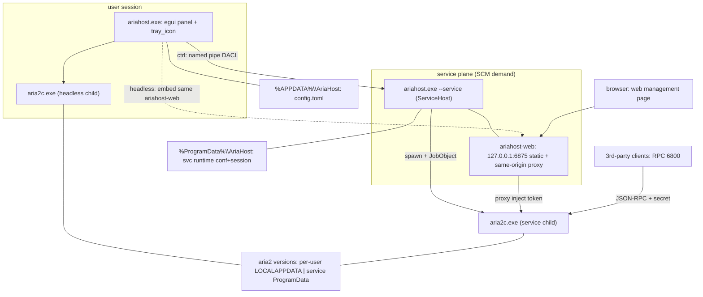
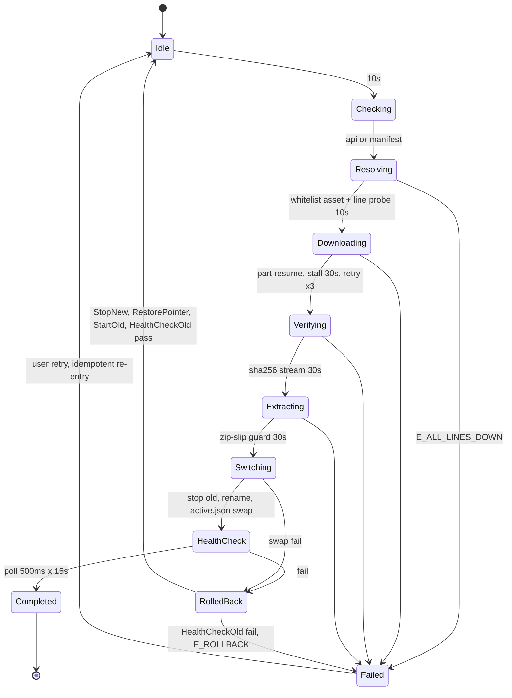
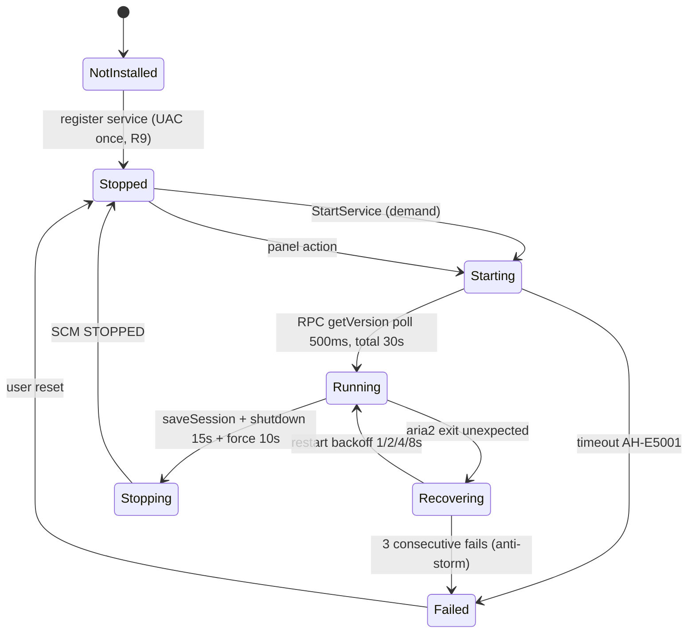

# wasm — AriaHost：aria2 Windows 服务管理器 · 架构设计

- 版本：**v2.2（M0 收口定版）**｜日期：2026-11-22｜状态：**已定版**（Q1–Q16 全部定版；**破坏性变更：无**——v2.1→v2.2 只关闭 §13 的 S1–S5 与登记 private 仓库派生的 CI 约束（§4.9.1），见 §15；v2.0→v2.1 见 §14；v1.4→v2.0 见 §12）
- 关联：`2026-11-22-wasm-需求分析.md`（F/N/Q 编号两文互通；数字同源，修改须同步）
- 事实基线：`.scratch/wasm-design/research-{gui,service,installer,cache-ux,version,egui}.md`（六份）；egui 栈的强制约束以 `research-egui.md` §9 的 EG-1…EG-15 为准；标【实测】【推断】【估算】【未验证】处不得升格为事实
- 执行层现状：`installer/ariahost.nsi`（**437 行**，task-14 + task-22 后）、`.github/workflows/{ci,release}.yml`、`docs/dev/{setup,build,ci,release,style,test}.md`、`docs/README.md`、`README.md`、`CONTRIBUTING.md` 已落盘，**但从未编译/运行**（本机无 cargo/makensis）；首次真跑在 M1（CI）与 M3（Release+NSIS），在此之前任何「安装器可用/CI 绿」都不是事实

> **已确认决策（2026-11-22 M0 定版；编号沿用 v1.2 校正后的 9 条原话，第 ⑩ 条为 v2.0 新增）**
> ① Windows 10/11 + Server，x86/x64 安装包（仅 AMD 架构，不含 ARM64）② Rust、轻量高性能、中文界面 ③ **命名已定 `AriaHost`**（原「wasm 是否合适」→ Q7=B；仓库代号 `wasm` 保留；全链落地见 §3.3）④ exe 安装包、方式/位置可选 + aria2 本地指定或在线下载（直连默认/镜像模板）⑤ 服务三模式、默认手动触发、动态优雅停止、统一异常 ⑥ 磁盘治理：先检测再提示、可配置带默认值、便捷清理 ⑦ 启动续传检测、退出提示、行为可配带默认 ⑧ aria2 位置可指定、在线升级到最新或选指定版本 ⑨ **下载管理三形态并存（已拍板）：面板内嵌任务列表 + 浏览器网页管理页 + RPC 开放第三方客户端；启动默认最小化托盘可配置** ⑩ **GitHub Actions CI 构建安装包 + 开发相关文档完整详细且精简准确**（v2.0 新增，落 F12/N8/验收 #12）。
> 待拍板项清零：Q1–Q16 全部定版（§6.1/§6.2），工程悬置 S1–S5 全部关闭（§13），M0 收口完成（§15）。

---

## 1. 需求概述

见需求分析文档 §1/§4（F1–F12）。本文回答：用什么进程拓扑、什么技术栈、什么状态机与数据布局，把这 12 组需求装进一个轻量、可维护、出厂安全的 Windows 应用里。非目标清单见 §3.4。

## 2. 现状分析：约束与既有资产

| 约束/资产 | 内容 | 来源 |
|---|---|---|
| 仓库 | 空仓（仅 README），无历史包袱；**无 `Cargo.toml`、无 `.cargo/config.toml`、无 `rust-toolchain.toml`** | 仓库现状 |
| aria2 官方 | 1.37.0=最新（2023-11-15 发布）；资产无官方哈希（digest 全 null）；GPLv2+OpenSSL exception；`--daemon` 在 Windows 空操作、无 SCM 入口 | research-service.md §3、research-version.md §2–§4 |
| 镜像线路 | r.alusss.cn 实测**整体不可用**（全路径 404 HTML 1253B/20s 超时/TLS 断连，2026-11-22）；GitHub 直连可用（302→206+Range） | research-installer.md §3 |
| Rust 工具链 | egui 0.37 整条栈 `rust_version = 1.95`、edition 2024；1.100 起 i686-windows 降为 Tier 1 without host tools（x64 宿主交叉）；32 位 Windows 通用支持 2025-10 已收尾 | research-egui.md EG-1、research-gui.md §7 |
| UI 栈 | **egui/eframe 0.37（wgpu）**：单进程、无系统 Web 运行时前置；默认 `MemoryHints::Performance` 开窗 ~250MB【实测 #8453】需改 `MemoryUsage`；中文 IME 有 #8813 级已知缺陷需纪律约束 | research-egui.md §3、§9 |
| 渲染/桌面兼容 | wgpu DX12 需 Windows 10 1809+ / WDDM2【推断】；老显卡/RDP 有 device loss 与超大窗口 panic（#8265/#8361，open） | research-egui.md §5–§6 |
| MSVC 运行库 | Rust MSVC 目标默认**动态链接 CRT**（依赖 `VCRUNTIME140.dll`，属 VC++ Redistributable，非 Windows 自带）；当前 CI 只上传单个 exe、安装包不含任何运行库 | `.github/workflows/ci.yml`/`release.yml` 现状；D13 |
| 配置/UX 规范 | 58 项侦察基线（去重后**定版 52 键**，逐键清单见 §4.11.1）、存储树、清理阈值、错误码段位、ST/MSG 规范已侦察定稿 | research-cache-ux.md §2–§9 |
| 版本窗口 | 在线窗口 24 版（1.19.1→1.37.0，无翻页）；升级 8 步状态机已侦察定稿 | research-version.md §3、§7 |
| 执行层交付物 | `installer/ariahost.nsi` **437 行**（MUI2/LogicLib/x64/WinVer、Unicode、`/SOLID lzma`、四宏 `/DARCH /DVERSION /DVI_VERSION /DSRCDIR`；per-user 隐藏服务组件、`.lnk` 写 AUMID、`--install-service`/`--uninstall-service`/`--write-aumid`/`--quit` 已接）；`release.yml` **只编 per-user 包**；`ci.yml` preflight+fmt+clippy+test+x64 release 单 exe | 仓库文件（未运行；状态表见 §4.10.1） |

## 3. 总体架构

### 3.1 进程与部署拓扑

三个运行平面：用户会话（GUI）、服务平面（ServiceHost，按需）、数据平面（aria2c）。控制走命名管道，数据走本机 RPC。**UI 不再是 Web 运行时多进程树：面板=单进程 egui，网页页=独立静态资产 + `ariahost-web`。**



要点：
- **GUI 关闭 ≠ 下载停止**：windows-service 模式下 aria2 由 ServiceHost 托管，网页页也由 ServiceHost 服务（GUI 关闭后浏览器页仍可用，见 research-service.md §9.3）；headless 模式下 GUI 进程内嵌同一 `ariahost-web` 组件，网页页随 GUI 存续。
- 控制面命名管道：DACL deny Network、allow SYSTEM/Administrators/Interactive + 握手 token（见 research-gui.md §4）；数据面 `127.0.0.1:6800` + `--rpc-secret`。
- aria2c 防孤儿三保险：Job Object KILL_ON_JOB_CLOSE + RegisterWaitForSingleObject 句柄 + RPC 心跳（见 research-service.md §4）。
- 面板与网页页是**两套 UI、一份 HTTP/JSON 契约**（不是同构复用），边界见 §4.5，前端形态见 §4.4。

### 3.2 模块划分（crate workspace）

| crate | 职责 | 首版 |
|---|---|---|
| `ariahost-common` | 错误码注册表（`AH-E####`）、配置 schema（TOML 解析/迁移）、MSG/ST 文案表、单实例/自启/DPI 等 Win32 膠水 | ✅ |
| `ariahost-aria2` | aria2 进程管理（拉起/优雅停止/心跳）+ RPC client + 版本管理器（下载/校验/切换/回滚） | ✅ |
| `ariahost-web` | axum 静态资源（`include_dir!` 内嵌）+ 同源反代 + token 注入 + shutdown 拦截 | ✅ |
| `ariahost-svc` | ServiceHost：`windows-service` 落地、SCM 交互、服务注册助手（`--install-service`/`--uninstall-service`）、嵌入 `ariahost-aria2`/`ariahost-web` | ✅ |
| `ariahost-ui` | egui/eframe 面板：托盘、任务列表（虚拟滚动）、设置、MSG/ST、通知降级链、AUMID 写入助手（`--write-aumid`） | ✅ |
| `ariahost-updater` | 自身更新检查（仅检查+提示，不自动装） | ⛔ 首版省略，M4 评估 |

UI 框架可整体替换：`ariahost-common/aria2/web/svc` 不依赖 UI 栈；换 UI 只重写 `ariahost-ui`（见 §4.1 切换成本）。crate 均在 `crates/` 目录下，产物单二进制 `ariahost.exe`（子命令区分面板/服务/助手）。

### 3.3 数据与端口

| 端口/路径 | 用途 | 默认 |
|---|---|---|
| 6800 | aria2 JSON-RPC/WS（第三方客户端共用） | localhost only |
| 6875 | 网页管理页（`web.port`，定版新增键） | 127.0.0.1 only |
| 命名管道 `\\.\pipe\ariahost-ctl` | GUI↔ServiceHost 控制 | DACL 见 §3.1 |

**命名全链落地（v2.0 定版，Q7=B 的执行口径）**：

| 项 | v1.4 | v2.0 定版 |
|---|---|---|
| 可执行 | `wasm.exe` | **`ariahost.exe`**（单二进制，子命令：无参=面板、`--service`、`--install-service`、`--uninstall-service`、`--write-aumid`、`--quit`；分派顺序见 §4.1.4） |
| 服务名/显示名 | `wasm-svc` | **`AriaHost`**（SCM 服务名与显示名同名） |
| crate | `wasm-*` | **`ariahost-{common,aria2,web,svc,ui}`**（`crates/`） |
| 安装目录 | `%LOCALAPPDATA%\wasm` | **`%LOCALAPPDATA%\Programs\AriaHost`**（per-user）/ `%ProgramFiles%\AriaHost`（全机变体，M4） |
| 配置 | `%APPDATA%\wasm\config.toml` | **`%APPDATA%\AriaHost\config.toml`**（`+ .bak`） |
| 服务运行时 | `%ProgramData%\wasm\` | **`%ProgramData%\AriaHost\`**（conf/session/logs/secret） |
| 版本库 | `%LOCALAPPDATA%\wasm\cache\aria2\versions\<ver>\` | **`%LOCALAPPDATA%\AriaHost\cache\aria2\versions\<ver>\`**（per-user 主路径）；服务平面**另持** `%ProgramData%\AriaHost\aria2\versions\<ver>\`（R9-b）。两平面**各自持有版本库与激活指针**（不是「不存在双库」），一致性由 **R11** 的比对/同步规则保证 |
| 控制管道 | `\\.\pipe\wasm-ctl` | **`\\.\pipe\ariahost-ctl`** |
| 注册表 | `Software\wasm` | **`Software\AriaHost`**（per-user=HKCU，全机=HKLM）；卸载项 `...\Uninstall\AriaHost` |
| 自启值名 | `wasm` | **`AriaHost`**（`HKCU\Software\Microsoft\Windows\CurrentVersion\Run`，免提权） |
| 安装包 | `wasm-setup.exe` | **`AriaHost-<ver>-x64-setup.exe`**（首版仅此；全机变体 `AriaHost-<ver>-x64-machine-setup.exe`，M4） |
| 日志 | `wasm.log` | **`ariahost.log`**（+ `aria2.log`） |
| 错误码前缀 | `WASM-E####` | **`AH-E####`**（R10；码段与四位数不变，仅前缀） |
| 配置键 | — | **不变**（TOML 组名与产品名无关，避免无谓迁移）；键集在 v2.1 收敛为**定版 52 键**，逐键清单见 §4.11.1 |

### 3.4 目标与非目标

目标：HTTP(S)/FTP 下载管理全生命周期 + 服务化 + 网页页 + 版本管理 + 一条命令出安装包。
非目标（首版不做）：BT/Metalink 管理（`bt.*` 三键=**保留键：不进 schema、不写 `aria2.conf`、不出设置页**；Q5 已拍板首版不做，不再「待拍板」）、多语言资源、aria2 核心自动升级（`auto_update=false` 恒定）、AriaHost 自身自动更新、公网远程管理、aria2 全选项平铺暴露、插件/DLL 扩展面（也是 D13 静态 CRT 的前提）。

---

## 4. 关键技术决策

> 每条：**结论 → 理由 → 被否方案 → 切换成本/不可逆点 → 来源**。Q1–Q16 已全部定版，正文不再有 ⭐。

### 4.1 D1 UI 栈：egui/eframe 0.37（冲突 1，Q1=A→B 的替换）

**结论：原生自绘 UI——`egui 0.37 + eframe 0.37（wgpu 后端）+ egui_extras 0.37`。无系统 Web 运行时、无浏览器内核依赖；面板与网页管理页是两套 UI、一份 HTTP/JSON 契约。轻量目标靠三项前提达成（§4.2.2），不靠「隐藏即销毁」这类缓解。**

三方案对比：

| 维度 | A. egui 单栈自绘（**选定**） | B. Web 运行时嵌入式壳（v1.4 方案，已否） | C. 纯 egui、不做网页页 |
|---|---|---|---|
| 开窗内存 | 50–70MB【推断】（三档见 §4.2.1） | 默认 250MB【实测 #8453】；缓解后壳 20–50MB 但需销毁/重建 WebView | 同 A |
| 中文输入 | 可用，但**必须遵守 EG-2 纪律**（禁止每帧 `request_focus`） | 浏览器级成熟 | 同 A |
| 安装前置 | **无**（不依赖系统组件版本） | 依赖系统浏览器内核与版本矩阵；Server 未预装【推断】 | 无 |
| 网页页（需求 9） | 独立零构建前端，`include_dir!` 内嵌（§4.4） | 同构双页复用一份前端 | ❌ 不满足需求 9 |
| 32 位 | i686 交叉可编，egui/wgpu 实机未验证【未验证】 | 官方 x86 路径（同样未实测） | 同 A |
| 开发量 | 面板 Rust 自绘 + 网页页前端各一套；面板范围已限定（§4.5） | 前端一套，两个部署目标 | 少一套前端 |
| 不可逆点 | 面板 UI 代码（约 40–55%【估算】的 UI 工作量）；网页页资产不受影响 | 前端技术栈与运行时依赖 | — |

理由：①用户硬指标「连开窗也 <100MB」在嵌入式 Web 运行时方案下无法保证（默认 250MB 是框架级默认，缓解只能藏窗口，用户一开窗就破线）；②不依赖系统 Web 运行时 = 去掉一整类安装前置与版本兼容风险（Server/离线机器收益最大）；③单进程把「常态/开窗」两个口径合并成一个可测数字，指标可归因（EG-4）；④网页页无论如何要写 Web 前端，但需求 9 对它只要求「完整任务管理」，用零构建 vanilla 交付，成本可控。
被否：B（内存指标与「无运行时依赖」两条都输，见上表）；C（不满足需求 9）；WinUI3/WinAppSDK（Rust 路径不成熟、托盘 issue、地板 Win10 1809，见 research-gui.md §2）；纯 Win32 自绘（成本失控）。
切换成本：UI 层独立 crate，`ariahost-common/aria2/web/svc` 零改动；若 egui 真机路线失败（IME 或内存），逃生路线依次为：①少数输入点改用原生 Win32 `EDIT` 子窗口覆盖（research-egui.md §10）；②换 Slint/iced（需重新侦察，UI 工作量重做）。**不回到 B**——内存指标是用户第 2 条的硬约束。

#### 4.1.1 依赖与 API pin（EG-1，防漂移）

| 依赖 | pin | 约束/理由 |
|---|---|---|
| `egui` / `eframe` / `egui_extras` | `0.37`（默认 features，含 wgpu） | 候选框跟随光标（#8681）、系统字体 provider、debug 内存修复只在 0.37；整条栈 MSRV **1.95**、edition 2024 |
| 工具链 | **pin 到具体版本（建议 1.95.x），M1 落 `rust-toolchain.toml`** | CI 现用 `dtolnay/rust-toolchain@stable` 会漂移，不满足 EG-1 下限；见 §13 **S2**（已关闭：`1.95`）与 §4.9.1 约束 5 |
| 系统字体 | `SystemFontProvider::new().with_locale(Some("zh-CN"))` | 中文一律走系统字体，**不内嵌 CJK**（内嵌=+5–10MB）；`default_fonts` 仅作拉丁/符号兜底（EG-5） |
| 表格 | `egui_extras::TableBuilder` | >200 行必须虚拟滚动（EG-8） |
| 托盘 | `tray_icon`（0.26.x，与 winit 事件循环同线程） | 无官方 eframe 集成；M2 必测左键菜单/200% 缩放/退出唤醒（spike 清单见 §8 风险表）。失败兜底：改用 `windows` crate 直接 `Shell_NotifyIconW`（`NOTIFYICONDATAW` + 自建隐藏消息窗口），功能面不变，只是自绘菜单替代原生菜单 |
| 文件对话框 | `rfd`（优先生成 `AsyncFileDialog`） | 在 winit 事件循环内的线程/COM 行为需 spike（同 §8 风险表，M2 前出结论）。失败兜底：用 `windows` crate 调 `IFileOpenDialog`（COM 需在 UI 线程 `STA`/`CoInitializeEx`），或退化为「文本框手填路径 + 校验」 |
| 通知 | `windows` crate（Toast + 托盘气泡 `Shell_NotifyIcon`） | AUMID 语义与降级见 R9 |
| 单实例 | **自写** `CreateMutexW` + `ERROR_ALREADY_EXISTS` + 命令行转发 | 不用 `single-instance` crate（2021 年后无更新，EG-12） |
| 服务/注册表/DPI | `windows-service` + `windows`/`winreg` 自写 | 无 eframe 官方集成，全部自写膠水（EG-15 的工程代价） |
| 静态 CRT | `-C target-feature=+crt-static`（`.cargo/config.toml` 按 target 设） | 见 D13 |

#### 4.1.2 UI 硬约束（EG-1…EG-15 落点表）

| EG | 约束摘要 | 落点 |
|---|---|---|
| EG-1 | 钉 0.37 全套 + Rust ≥1.95 | §4.1.1、M1 工具链 pin |
| EG-2 | **禁止每帧 `request_focus`** | §4.1.3、验收 #13、M2 门禁 |
| EG-3 | `MemoryHints::MemoryUsage`（默认 `Performance` 开窗 ~250MB【实测 #8453】） | §4.2.2 前提①、验收 #11 |
| EG-4 | 内存口径=release/60s 稳态/`PrivateWorkingSetSize`/含开窗 | §4.2.1、N1、验收 #11 |
| EG-5 | 中文走系统字体、不内嵌 CJK、locale=zh-CN | §4.1.1 |
| EG-6 | 字体 provider 首帧前注册+预热；枚举放后台线程（枚举可能数百 ms，未完成时查询阻塞） | §4.1.1、N2 |
| EG-7 | 字体图集 `max_texture_side = 2048`（2048²≈16.8MB 显存【推断】） | §4.2.2 前提② |
| EG-8 | >200 行必须 `TableBuilder::body().rows()`/`show_rows` 虚拟滚动 | §4.2.2 前提③、F3 |
| EG-9 | 行数据 `Arc<str>` 共享、图标 LRU ≤200 张 32²、禁每帧 `format!`/`clone`、日志环形缓冲 ≤5k 行 | §4.2.2 前提③ |
| EG-10 | wgpu 主 + `--renderer=glow` 逃生口 + `Device::on_uncaptured_error` 重建不崩溃 | §4.2.4 |
| EG-11 | 窗口尺寸/位置钳制（≤8191px，`available_monitors` 校验；#8361 open） | §4.2.4 |
| EG-12 | 单实例自写（见 §4.1.1） | F3/验收 #5 |
| EG-13 | 安装器：per-user 默认、AUMID、升级杀进程、服务注册语义 | §4.10、R9 |
| EG-14 | 网页页零构建 vanilla + `include_dir!` + 契约先行 | §4.4 |
| EG-15 | IME 真机门禁 + 同一门禁量三档内存 | M2、验收 #11/#13 |

#### 4.1.3 IME 纪律（EG-2，写成硬约束而不是「能力具备」）

**事实（已核验）**：egui Issue #8813 标题为「IME composition is interrupted when focus stays within the same text edit (request_focus on the focused widget every frame)」；根因是 `Memory::request_focus` **无条件**调用 `interrupt_ime()`，修复 PR #8814/#8885 截至 2026-11-22 **未合并**。因此这不是「版本会不会修」的问题，是**我们必须不写那种代码**。

**硬约束（写进 code review checklist + CI 源码扫描）**：
1. 全项目**禁止**在 `update()` 每帧路径上调用 `request_focus` / `request_focus_next_frame`，包括包装组件内部与 `Response::request_focus` 循环；
2. 需要锁定焦点时，只在「焦点状态发生变化」时调用一次（比较 `ctx.memory(|m| m.focused())` 前后值），或自行维护焦点 id、用 `TextEdit::id` 静态指定；
3. 任何「输入框自动聚焦/编辑后保持焦点」的需求，一律用 `id` 稳定化实现，不用每帧抢焦点；
4. M2 开工前在 CI 增一条源码扫描规则（`crates/ariahost-ui/src/**` 命中即失败，白名单仅允许单次焦点变更调用点）——**该规则目前不存在**，属 M2 前置待办，不计入已交付能力。

**验收（#13，与需求 #13 同一行口径）**：面板内**必测三类文本输入**——新建任务 URL、设置-下载目录、列表搜索框——× 微软拼音与搜狗输入法 × 连续输入中文 30 字 → 不丢字、候选框跟随光标、中英切换（Shift）正常、点击别处正确打断（组合串提交或取消符合输入法预期）；设置页其余文本键（镜像 URL 模板、RPC 端口、代理）同一 `TextEdit` 实现，各抽 10 字同类覆盖；另需 CI 源码扫描零 `request_focus` 违例。**M2 门禁项，不通过不得进入 M3。** 网页页 URL/搜索框的中文输入为浏览器侧附注（缺陷记 #17），**不得用来证明 egui IME**。
兜底（仅当门禁失败）：少数输入点改用原生 Win32 `EDIT` 子窗口覆盖（research-egui.md §10）；再失败换 Slint/iced（重侦察）。

#### 4.1.4 启动分派与单实例（M7：argv 必须早于 mutex）

**顺序硬约束**：`main()` 第一步先解析 `argv[1..]`，**再**决定是否创建 `/` 检查单实例 mutex。理由：短命助手（安装器/卸载器/覆盖安装调用）在面板运行中也会被拉起，若先抢 mutex 会被 `AH-E9001` 拒掉，导致「服务装不上、覆盖安装退不出来」这类看起来像 bug 的假失败。

| argv | 形态 | 参与 GUI 单实例 mutex | 行为 |
|---|---|---|---|
| 无参 | 面板（GUI） | ✅ 是 | 抢 `Local\ariahost-gui-<用户SID>`；已存在→激活已有窗口并转发命令行→本进程退出；不创建窗口的失败路径写日志后退出码 1 |
| `--service` | ServiceHost | ❌ 否 | 由 SCM 拉起，自己拉 aria2c；重复启动由 SCM 自身语义处理（第二个 `sc start` 返回「已在运行」） |
| `--install-service` | 短命助手（提权） | ❌ 否 | 四步注册（R9），stdout/退出码给安装器；面板运行中亦须可执行 |
| `--uninstall-service` | 短命助手（提权） | ❌ 否 | 对称四步；`--install-service` 的回滚也用本命令 |
| `--write-aumid` | 短命助手 | ❌ 否 | 给开始菜单/桌面 `.lnk` 写 `System.AppUserModel.ID`（R9），不碰服务、不开窗 |
| `--quit` | 短命助手 | ❌ 否 | 向 `\\.\pipe\ariahost-ctl` 发优雅退出握手：成功 `0`、无实例 `1`、管道在但握手失败→安装器弹框建议重试或重启；**不再 `taskkill /F`**（避免杀到别的用户/半状态） |

只有「面板模式」参与 mutex：mutex 名带用户 SID（`Local\` 命名空间），多用户各自一份，不互相顶掉。短命助手一律**不注册窗口类、不初始化 wgpu**，失败只写日志+退出码，保证在 Server Core 上也能跑（#15a）。
并发用例归属：面板运行中装服务=#3b；面板运行中再点一次图标=#5；面板运行中覆盖安装/卸载=#14（含 `--quit` 握手）、#12（release 包）。

### 4.2 D2 进程与内存模型（含 ServiceHost）

**结论：单进程（`ariahost.exe`，面板内建 egui/winit/wgpu 与 aria2 管理）+ 一个 aria2c 子进程；服务模式由 SCM 拉起同一 exe 的 `--service` 形态，再拉起自己的 aria2c 子进程。不用 Web 运行时多进程树。**

#### 4.2.1 内存口径与三档预算（EG-4，写死口径才能归因）

**测量口径（两文一致，test.md 按此回填）**：release 构建；启动后 **60s 稳态**；取 `GetProcessMemoryInfo → PrivateWorkingSetSize`（≈任务管理器「内存」列）；**含开窗**；同时记录 commit 与 GPU 专用内存作附件。不达标时必须能回答「是哪一档、哪个前提没做」。

| 档 | 场景 | 预算（`ariahost.exe` 单进程） | 门禁 |
|---|---|---|---|
| ① 托盘无窗 | 窗口从未创建或已关闭，托盘常驻，60s 稳态 | 目标 **≤60MB**（预估 30–50MB【推断】） | 报告项：超标必须归因，不判失败 |
| ② 开窗闲置 | 面板打开、列表 20 行、无任务，60s 稳态 | 预估 50–70MB【推断】 | **<100MB 硬门禁**（用户第 2 条口径） |
| ③ 下载中开窗 | 3 个任务并发、列表 5000 行虚拟滚动、速率图开、持续 1h | 预估 65–90MB【推断】 | **<100MB 硬门禁** |

分列不计入门禁：`ariahost-svc`/ServiceHost 3–10MB【推断】、aria2c 5–60MB【估算】（aria2 自身的内存不属本产品 UI 指标）。
剩余预算只有 10–35MB → 这就是为什么前提②③是硬条件而不是优化建议。

**门禁列判读（m3）**：只有 ②③ 是硬门禁（`<100MB`，超标即失败）；① 是**报告项**——超标不判失败，但必须写清「哪一档、哪个前提没做、差多少」。三档必须**同时**记录，只报 ② 不报 ①③ 视为无效测量。

**③ 的夹具（与需求 #11 同一份，不得另造）**：固定种子脚本生成 **5000 行**列表数据（每行 1 条任务 + 6 字段：文件 URL、GID、状态、总大小、当前速率、完成时间），经 `--fixture=5000` 注入面板列表；同机再跑一次 20 行基线。判据两条：①60s 稳态 `PrivateWorkingSetSize` 与 20 行基线的差值应 <15MB（差值大=虚拟滚动没生效或行数据未共享）；②滚动到底部无逐帧掉帧（`frame_time` p95 <16.7ms）。夹具文件与生成脚本进 `crates/ariahost-ui/tests/fixtures/`（M2 落盘；此目录当前不存在）。

#### 4.2.2 三前提（缺一不可，任何一条缺失都会让 <100MB 变成不可归因的 200MB）

| # | 前提 | 不做会怎样 | 落点 |
|---|---|---|---|
| ① | `wgpu::MemoryHints::MemoryUsage`（device descriptor，API 以 0.37 编译为准） | 默认 `Performance` 开窗 **~250MB**【实测 #8453】→ 用户第一眼就看到 250MB | EG-3、验收 #11 |
| ② | 字体图集钉 `max_texture_side = 2048`（必要时 4096，但需记录）；CJK 走系统字体 | 默认按需长到 8192 → 单边翻倍显存 ×4（64MB+），共享内存顶高 | EG-5/EG-7、验收 #11 |
| ③ | 列表虚拟滚动（`TableBuilder`）+ 行数据 `Arc<str>` 共享 + 图标 LRU ≤200 + 禁每帧 `format!` | 万级全量布局每帧 O(n) galley 分配 → 掉帧 + 内存爆 | EG-8/EG-9、F3、验收 #11 |

#### 4.2.3 ServiceHost 结论（保留 v1.4 结论，仅改名）

**自研 Rust ServiceHost（`windows-service` crate）托管 aria2c 子进程。** aria2c 无 `StartServiceCtrlDispatcher`（`sc create` 直接托管 30s 后 1053 错误）、`--daemon` 在 mingw 构建静默空操作（`daemon()` 体在 `#ifdef HAVE_WORKING_FORK` 内，见 research-service.md §3）。
被否：NSSM/WinSw（通用包装器，无 RPC 感知、无优雅停止语义）；libaria2 内嵌（GPL+维护成本）；计划任务替代服务（无 SCM 语义）。切换成本：低，`ariahost-svc` 独立 crate。

#### 4.2.4 渲染健壮性（EG-10/EG-11，新增）

- 后端策略：wgpu 为主；保留 `glow` feature + 启动参数 `--renderer=glow` 作为逃生口（老显卡 #2573、RDP #8265）。
- 全进程安装 `Device::on_uncaptured_error`：device lost/uncaptured error 时重建渲染器（重新 `Surface::configure`）并提示「已切换兼容模式」，**不 panic、不静默退出**。
- 窗口尺寸钳制 ≤8191px（含恢复保存的尺寸）；恢复位置按 `available_monitors` 校验并夹到可见区域（#8361 未修，拖一次窗口就退出是真实风险）。
- 托盘常驻时**禁止常驻动画**；进度/速率刷新只在窗口可见时进行（research-egui.md §8.12）。

### 4.3 D3 IPC 选型

**结论：控制面命名管道（tokio ServerOptions），数据面 RPC。** 服务账户 `LocalSystem`（默认；见 R9 理由：per-user 安装的 exe 位于用户 profile，只有 LocalSystem/管理员组可稳定访问）；LocalSystem 下 `%APPDATA%`/`%LOCALAPPDATA%` 会解析到 systemprofile，**必须显式全路径**（见 research-service.md §8）。
被否：127.0.0.1 TCP 控制面（多占端口、防火墙提示风险）；共享内存（复杂度不匹配）。切换成本：低，`ariahost-common` 内抽象。

### 4.4 D4 网页页托管、secret 注入与前端形态（冲突 6 + EG-14）

**结论：网页页由「当前托管 aria2 的进程」内嵌 `ariahost-web` 提供（服务模式=ServiceHost，headless=GUI）；HTTP 组件监听 `127.0.0.1:<web.port>`（默认 **6875**，可改），serve 静态资产 + 同源反代 aria2 RPC + 注入 `token:<secret>` 首参，浏览器永不持有 secret；反代层拦截 `shutdown`/`forceShutdown`（防 XSS 一键关机，改走面板受控停止）。**

**前端形态（v2.0 定版，EG-14）：零构建 vanilla**（原生 ES module + 手写 CSS，无打包器），资产 `include_dir!` 编译期内嵌进 `ariahost.exe`；API 契约先行（M1 随 `ariahost-web` 定稿接口清单：端点/参数/错误码/字段类型），面板与网页页都按同一契约实现。若将来改 Vite/React 必须另立任务并补 CI 工具链（Node 版本锁定+构建产物校验），**不在本版范围内**——理由：CI 面与供应链风险翻倍，而网页页只需要任务表格与表单。
**代价（说清楚）**：面板与网页页不再共享前端代码，UI 工作量比 v1.4 的同构方案高【估算 +30–40% UI 工时】；换来的是面板零运行时不依赖 + 网页页零构建。

secret 注入三方案对比：

| 方案 | 评价 |
|---|---|
| **同源反代注入（选定）** | CORS 与 secret 一次解决；浏览器只见到同源 `127.0.0.1:<web.port>`；反代可做方法白名单 |
| 一次性配对 token | 需配对 UI 流程+token 生命周期管理，复杂度高，收益不增 |
| HttpOnly cookie 会话 | RPC 是 JSON-RPC 非 cookie auth，仍需反代层翻译，等于上一方案+额外会话态 |

理由：另两方案都以反代为前提再叠加机制；同源反代最少活动部件（见 research-service.md §9.3）。
被否：浏览器直连 6800（secret 进浏览器内存+须开 `--rpc-allow-origin-all`，风险放大）；GUI 进程独立托管网页页（服务模式下 GUI 关闭页面即死，与已拍板形态矛盾）。
RPC 档位（已定口径）：默认 `localhost`+自动 32 位 secret（DPAPI 存 `secret.bin`，设置页 `•••`+显示/复制供第三方客户端）；`lan` 默认关+MSG-U08 二次确认+防火墙预建（netsh 仅 Private/TCP/localsubnet；平台知识【未验证】，M1 实测确认，见 research-service.md L379–382）；`off` 关闭 RPC 需确认。切换档位不重置 secret（见 research-cache-ux.md §9.4）。

### 4.5 D5 第 9 条三形态职责边界（用户拍板形态的落地定义）

| 形态 | 职责 | 不做 |
|---|---|---|
| 面板内嵌任务列表 | 分组列表/速度/进度、暂停/继续/删除、状态栏（版本·来源·服务态）、一键打开按钮、设置；**三种文本输入：新建任务 URL、设置-下载目录、列表搜索框（过滤当前列表，不检索历史）** | 批量编辑、任务高级选项、历史检索 |
| 网页管理页 | 完整任务管理：添加/编辑/批量/每任务高级选项/详情/历史（AriaHost 侧持久化） | 系统级设置修改（设置归面板，网页页只读展示） |
| 第三方客户端 | RPC 直连 6800，secret 自取 | — |

> **v2.1 裁定（IME 门禁反推 UI 面）**：面板**必须**提供上表三种文本输入——新建任务 URL（单任务快捷添加，批量仍归网页页）、设置-下载目录、列表搜索框（仅过滤当前列表）。理由：验收 #13 要求 IME 在面板内可测，若这三处不在面板，则该门禁无法执行（第三轮评审 M2/m7）。搜索框不等于「历史检索」（不做项不变）。

一键打开（三入口：面板按钮/托盘菜单/`Ctrl+Shift+M`）降级链：服务运行→直接开；未运行→MSG-U05「启动并打开」（走 ST-01→ST-03）；aria2 缺失→MSG-U06 引导（在线下载/选本地 exe/稍后）；无默认浏览器→`AH-E9004`；内置页失败→`AH-E9003`（见 research-cache-ux.md §9.2）。托盘菜单「打开下载管理」恒可用（置灰会堵死拉起路径，见 research-cache-ux.md §9.3）。
URL 恒由 `web.port` 渲染（`http://127.0.0.1:<web.port>/`，默认 6875），**禁止硬编码 6875**。托管进程启动时先对 `web.port` 做 bind 探测（`TcpListener::bind` 后立即释放）：被占→`AH-E3001`（web 子字段，文案「网页页端口被占用」+「改端口」/「查看占用进程」两个动作），**不得静默回落**到 6875 或换随机端口——否则用户点「一键打开」会开到别人的服务上。改端口成功后写回 `config.toml` 并重启网页托管（不重启 aria2）。

### 4.6 D6 服务模式默认与互斥（冲突 5）

**结论：`service.start_type="manual"` 的准确语义=SCM StartType=demand——系统开机不自动拉起服务，面板/网页页/托盘操作时按需 `StartService`。`service.mode` 内置默认 `headless`；服务注册成功后写 `windows-service`。注册动作与安装模式配对见 R9：**per-user 默认包安装期不注册、不显示服务组件**，用户装后在设置页点「安装为服务」触发单次 UAC 助手；**只有全机变体（per-machine，M4 提供）安装期才可勾选服务组件**。两条路径最终都走同一个 `--install-service` 助手，不存在第二种注册实现。**

互斥与切换规则（6800 独占，不可双开）：
1. 任意时刻仅一个 aria2 实例：切换模式必经完整停止链（saveSession→shutdown→15s→forceShutdown→10s→强杀）；
2. 停止后探测 6800 释放（bind 探测）再启动新形态，未释放报 `AH-E3001`（文案区分「端口被其他程序占用」与「疑似另一个 aria2」，见 research-cache-ux.md §3.3）；
3. 端口占用先 bind 探测提示改端口；检测到外部 aria2 实例→只读模式接入提示。
4. **模式收敛**：`service.mode≠windows-service` 而服务注册残留时，面板状态栏提示「检测到已注册的 AriaHost 服务但当前为面板直跑模式」，建议卸载或明确告知后果；此状态下外部 `sc start` 拉起第二实例→6800 绑定失败→ServiceHost 上抛 `AH-E3001` 至面板（不静默转 Failed）。
服务未启动时：面板可用（只读态+一键启动），网页页静态资产可开（操作走同一降级链）。

**运行时文件双平面（R7，v2.0 补 secret 与版本库）**：

| 数据 | headless（用户态） | windows-service（服务态） |
|---|---|---|
| 受控 aria2.conf / session / 日志 | `%APPDATA%\AriaHost\runtime\` | `%ProgramData%\AriaHost\`（ACL：SYSTEM/Administrators 完全、Users 读） |
| RPC secret | `%APPDATA%\AriaHost\secret.bin`（DPAPI user scope，面板直接解密） | `%ProgramData%\AriaHost\secret.bin`（DPAPI machine scope + `CRYPTPROTECT_LOCAL_SYSTEM`；**只有 ServiceHost 解密**，面板经控制管道取值，见 §4.6.1）【M1 验证】 |
| aria2 版本库 | `%LOCALAPPDATA%\AriaHost\cache\aria2\versions\`（**单一事实源**） | `%ProgramData%\AriaHost\aria2\versions\`（注册时由提权助手复制的**只读快照**，同步规则见 R11/§7.2） |

下载目录沿用用户目录；服务注册的 UAC 步骤一并执行 icacls 授权（用户免手动）。

#### 4.6.1 服务平面 secret 的威胁模型（m5）

**要防什么、不防什么**（先划边界，否则「machine scope 面板可解密」就是自相矛盾）：

| 威胁 | 处置 | 结论 |
|---|---|---|
| 同机**其他普通用户**读到 secret，直连 6800 绕过面板 | secret 文件 ACL=`SYSTEM:F`+`Administrators:F`（**Users 无读**）+ DPAPI `CRYPTPROTECT_LOCAL_SYSTEM`（仅 SYSTEM 账户可解）；`ariahost-ctl` 管道 DACL=SYSTEM/Administrators 完全 + **安装者 SID** 读写，其他用户拒绝 | 挡住 |
| 网页页 XSS 偷 secret | 浏览器永不持有 secret（同源反代注入，§4.4）；反代拦 `shutdown`/`forceShutdown` | 挡住 |
| secret 落进配置文件/日志/诊断包 | 不进 `config.toml`；日志与诊断包统一脱敏为 `token:***`（§4.12 诊断打包同一规则） | 挡住 |
| 复制 secret 文件到另一台机器解密 | DPAPI machine scope 绑定机器，移机解密失败 | 挡住 |
| 本机**管理员**读内存/改配置/替换 exe | 管理员本来就能 `sc stop`、改 binPath、dump 进程内存 | **不防**（明确接受） |
| 面板崩溃后 secret 不可用 | 面板只读展示，真值始终在 ServiceHost；面板重启后经管道重取 | 无影响 |

**面板如何拿到 secret**：`ariahost-ctl` 管道新增 `GetRpcSecret` 请求（仅授权 SID 可调），返回 `token:<secret>` 供设置页 `•••`/显示/复制给第三方客户端；**面板不读 `%ProgramData%\AriaHost\secret.bin`**。面板不缓存到磁盘，只在内存持有到本次会话结束。

**M1 两条验证**（不通过则退 B）：①LocalSystem 服务用 `LocalSystem` flag 加密的 blob 能被同一账户解密、被用户令牌解密失败（预期 `ERROR_ACCESS_DENIED`/`CryptProtectData` 失败）；②非授权用户请求 `GetRpcSecret` 被管道 DACL 拒绝。**退 B（仅当①不成立）**：去掉 `CRYPTPROTECT_LOCAL_SYSTEM`（退回普通 machine scope），安全边界完全依赖文件 ACL+管道 DACL，威胁模型表前两行结论不变、但「同机用户若拿到文件副本仍可解密」需在 §8 风险表记一条低风险。

### 4.7 D7 aria2 核心组件管理（冲突 7 + 契约第 6 项）

**来源模型 `Aria2Source::{Managed, External, Bundled}`**（见 research-version.md §6）：
- `managed`（**定版默认**，见 §7 裁决 R1）：版本库多版本共存（路径随安装模式，见 §3.3/R9-b）+ `active.json` 原子指针（version/switched_at/last_health/previous 单代回滚）+ `staging\` 下载/解压原子区；
- `external`：用户指定 aria2c.exe，只读绝不写删不升级；切换必须过健康检查（启动+`--version`+RPC 能力探测），失败回滚保原来源（`AH-E6006`）；
- `bundled`：构建期可选特性，首版不启用（离线包变体 M4 后评估，见 research-installer.md §4）。

**版本发现**：GitHub API `releases?per_page=100` 一次全量 24 版窗口（1.19.1→1.37.0）；资产白名单正则 `^aria2-\d+\.\d+\.\d+-win-(32|64)bit-build\d+\.zip$`（build 编号可变、排除 -debug，绝不硬编码 build1）；官方 digest 全 null→SHA-256 构建期自算入内嵌 manifest，运行期只比对；同版本合并规则：API 的 URL/size 为准、manifest 的 sha256 为准（见 research-version.md §3–§4、§8）。

**升级状态机（8 步）**：



设计要点：①–⑤ 可取消（清 staging）；⑥ 唯一秒级停机窗口且不可取消；下载与替换解耦，旧版在 ①–⑤ 全程服务；检查≠安装；幂等中断重启清 staging 重入（见 research-version.md §7）。文件占用：版本目录不原地替换（架构消解），兜底 `MoveFileEx(old→.old)` 两步改名；不用 PendingFileRenameOperations（HKLM+重启，明确不做）。

**回滚进程序列**：HealthCheck 失败或 Switching 中 swap 失败→**StopNew**（完整停止链，强杀上限 10s）→**RestorePointer**（`active.json` 原子回拨 `previous`）→**StartOld**（spawn previous 版本）→**HealthCheckOld**（RPC 轮询 500ms×15s）→通过即回 **Idle** 恢复服务；HealthCheckOld 失败→**Failed**{E6008 需人工介入（重装/切 external）}。**回滚验收判据（写死）=运行进程版本 == `active.json` 指针版本 == RPC `getVersion` 返回版本；三者任一不一致即视为回滚失败，任何时刻不允许出现「指针=旧版/运行进程=新版」的分叉态**（指针回拨先于起旧进程，StartOld 失败绝不回拨后再悬空）。

**升级期待管理（冲突 7）**：aria2 上游仓库活跃（pushed_at 2026-06-25）但发布极慢——1.37.0 自 2023-11-15 即最新，「检查更新」长期返回无更新是**常态而非故障**。四态文案（绝不合并）：无更新（文案解释发布节奏，显示当前版本+日期）/网络故障（E6001）/代理返回非 JSON（BadPayload，E6001 文案区分）/429 限流（E6002，静默退避连续 3 次才提示）。默认 `check_update_on_start=true` 且无更新零打扰（裁决 R5）。

### 4.8 D8 网络线路与安装策略（冲突 2 + 冲突 4，Q2/Q4 已定）

**结论（冲突 2，Q2=直连默认）：默认线路改直连（GitHub release-assets），r.alusss.cn 降级为可配置镜像 URL 模板（`{url}` 占位、多模板按序、安装引导与升级器共享同一出口配置）。每线路使用前预检：HEAD 或 `Range: bytes=0-1` 首字节验证 Content-Type 非 text/html + Content-Length 与 manifest 一致 + zip 魔数 `PK\x03\x04`（5s 超时×2 次）；失败自动回退+可见提示（`E_PROXY_DOWN` 类信息条，不静默降级）。**
理由：r.alusss.cn 2026-11-22 实测全路径 404/超时/TLS 断连=服务失效，不是拼接问题（见 research-installer.md §3）；坚持默认线路 1 = 首装在线下载失败率 100%。镜像模板化保留其修复后可用性。
被否：硬编码镜像前缀；默认线路 1（首装即败）。

**结论（冲突 4，Q4=不阻断）：aria2 在线下载失败不阻断安装——装完无 aria2 时面板进入引导态（MSG-U06：在线补装/选本地 exe/稍后，状态栏常驻「aria2 未安装 · 点击修复」）。**
理由：阻断安装把「线路故障」升级为「装机失败」，且本地兜底用户完全可用；引导路径与升级器同一下载管线（回退链一致，见 research-installer.md §5）。
被否：强制阻断（最差首装体验）；首版内嵌 bundled（GPL 分发义务+版本耦合+杀软误报，见 research-installer.md §4）。
文案要点：失败错误卡给「重试/换本地文件/查看帮助」三动作+明确「AriaHost 已安装成功，仅下载核心未就绪」。
SHA-256：官方无哈希→构建期自算 `aria2-manifest.json` 与应用版本绑定；Scoop 第三方哈希仅交叉对照，不一致报警停发（见 research-installer.md §5）。

### 4.9 D9 32 位能力边界（冲突 3，Q3=M4）

**结论：首版发布 x64 包；i686 目标保留（x64 宿主交叉编译，std 预编译可用），但「M4 前不进 CI 矩阵」（私有仓分钟预算，见 §4.9.1，不挂 `continue-on-error`）；x86 包在 M4 交付，门槛=i686 release 构建绿 + NSIS 32 位路径实测 + egui/eframe/wgpu 在 i686 上可用（DX12 设备创建、4GB 地址空间下图集/缓冲）【未验证】+ x86 版 aria2 资产可得（官方 win-32bit 2,558,495B，见 research-version.md §2）。**
理由：Rust 1.100 起 i686 降为 Tier 1 without host tools（官方博客 2026-10-02）；32 位 Windows 通用支持 2025-10 已收尾（见 research-gui.md §7）；双架构测试矩阵×2 无 32 位需求数据支撑；**v1.4 的「系统 Web 运行时 x86 存在性」门槛已随 UI 栈切换消失**，换成 egui/wgpu i686 实测门槛。
被否：首版双包（矩阵翻倍拖慢 GA）；彻底放弃 x86（需求 ① 字面承诺 32 位包）。

#### 4.9.1 private 仓库派生的 CI 约束（Q15/S4，v2.2 新增）

**事实口径**：GitHub Actions 的 Windows runner 在**私有仓库**按 **2× 分钟**计费；Free 计划私有仓 2000 分钟/月 ≈ **1000 分钟**实际 Windows 构建时间（公开计费规则，非本项目实测）。因此「每次 push 都全矩阵编译」不可持续，流水线按下列五条定版：

| # | 约束 | 落地 |
|---|---|---|
| 1 | **发布矩阵收敛为单条**：`release.yml` 只编 **x64 per-user** 一个包（`AriaHost-<VERSION>-x64-setup.exe`） | 验收 #12（M3 首跑）；全机变体 M4 进矩阵（§4.10 变体表） |
| 2 | **PR CI 只跑 x64**：preflight + fmt + clippy + `cargo test` + `cargo build --release`，不矩阵、不跑 x86 | `ci.yml`（M1 首跑） |
| 3 | **x86 与全机变体 M4 前不进矩阵**——不是挂 `continue-on-error`：挂着同样吃分钟，且失败被静默吞掉比不跑更坏。**Q3 的 M4 承诺不变**（i686 构建绿 + NSIS 32 位路径 + egui/wgpu 实机），只是执行时点排在 M4（§4.9） | `release.yml` matrix；M4 门槛见 §9 |
| 4 | **省分钟机制**：`concurrency: cancel-in-progress`（同 ref 新 push 取消旧跑）+ **变更判定 job**（`changes` 判定代码路径；纯 `docs/**`、`*.md`、`.scratch/**` 只跑 `meta`+`gate`，不跑编译）。**不用 `on.push.paths` 过滤**——paths 不命中时整个 workflow 不触发，PR 上就没有 CI 状态、分支保护会永久 pending | 两工作流；已按 task-22 落地（**未经 CI 实跑**） |
| 5 | **工具链 pin 记录点**：`rust-toolchain.toml` 的 `channel = "1.95"`（Q14/S2，minor 内追随 patch），与 `.cargo/config.toml`（静态 CRT，D13-A）M1 同批落；**CI 首次绿后把实际 patch 版本回填本节**与 `docs/dev/build.md` | M1 |

> 本节只登记「范围与时点」，不改 §4.9 的 32 位能力结论；`ci.yml`/`release.yml` 已落盘但**从未运行**（§4.10.1），任何「CI 绿/矩阵就绪」在 M1/M3 首跑前都不算事实。

### 4.10 D10 安装器（自写 NSIS，Q4 落地 + R9）

**结论：自写 NSIS 3.x 脚本 `installer/ariahost.nsi`（现 437 行）**已在 windows-latest 真实编译、打包并发布成功**（2026-11-25；探针 run 45452855606 定位路径约束，首发 run 45451494558 因此失败，修复后 Release run **45454312274** 全绿，产出 `AriaHost-0.1.0-x64-setup.exe` 196078 字节）：MUI2 + LogicLib + x64 + WinVer + FileFunc，Unicode，`SetCompressor /SOLID lzma`，产物 `AriaHost-<VERSION>-<ARCH>-setup.exe`；编译期宏 `/DARCH /DVERSION /DVI_VERSION /DSRCDIR`。

> **编译期路径硬约束（2026-11-25 实证）**：Windows 版 `makensis` 的 `File` **只接受全反斜杠的绝对路径**——run 45452855606 五用例：`D:\a\...\x64\ariahost.exe` exit 0；`D:/a/.../x64/ariahost.exe` exit 1；相对 `dist\x64\ariahost.exe` exit 1（按脚本所在目录解析）；正斜杠的 `D:/a/_temp/...` exit 1。Linux 版接受 `/`，故 Linux 上编译通过对 Windows 零证明力；**不要为跨平台把 `\` 改回 `/`**。
>
> **仍【未验证】**：真机安装/卸载（无人点过向导）、`/S` 静默、AUMID 写入是否生效、服务注册助手（`--install-service` 等）的实际行为。PE 版本资源已实测正确（`FileVersion`/`ProductVersion` = `0.1.0`、`LegalCopyright` = `Copyright (c) 2026 Alusss`、`FileDescription` 中文正常）。

**两种编译变体、首版只发布一种**：
| 变体 | 执行级别/上下文 | 目录/注册表 | 首版发布 |
|---|---|---|---|
| **per-user（默认，唯一发布）** | `RequestExecutionLevel user`、`SetShellVarContext current` | `$LOCALAPPDATA\Programs\AriaHost`、HKCU | ✅ `release.yml` 只编此包 |
| 全机（`makensis /DPER_MACHINE`） | `admin`、`SetShellVarContext all` | `$PROGRAMFILES64\AriaHost`、HKLM | ⛔ 同源编译变体，M4 进 release matrix |

**为什么首版只发 per-user 单包**：①已定目标「默认免 UAC」（用户第 4 条、验收 #1）只有 per-user 能兑现；②`RequestExecutionLevel` 是编译期常量，一套脚本同时承载两种提权语义要写两套目录/注册表/UAC 分支与两份测试矩阵，收益不抵风险；③全机安装的核心价值（多用户共用）首版无需求信号，而**服务注册已可运行时按需 UAC 完成**（R9），不需要靠全机安装换服务能力。若要求首版双包：M3 +2–4 人日【估算】、验收 #1 变双口径，不推荐。
被否：向导内选安装模式（运行期切换提权语义在 NSIS 需按需提权改造，未验证且成本同双包）；MSI/WiX（模板成本）。

**取消安装器内 aria2 来源页（v2.0 决定）**：已交付脚本无该页，且**不应补**——把在线下载/校验/代理预检/回退链搬进 NSIS 等于在没有单测的脚本里重写一遍升级器。来源选择统一到**首次运行 MSG-U06**（在线/本地/跳过）+ 设置页「重新获取核心」；安装器只保留「同目录自带 `aria2c.exe` 则一并安装」的既有逻辑。需求 F1/F2 同步此口径。

**安装包内容清单（D13 的结果，也是装机完整性的定义）**：

| 内容 | 随包 | 说明 |
|---|---|---|
| `ariahost.exe` | ✅ | 唯一 exe；静态 CRT（D13）；网页页资产/图标/文案编译期内嵌；**无任何 DLL** |
| `uninst.exe` | ✅ | NSIS 生成 |
| `aria2c.exe` | ❌ 默认不带 | 首次运行/版本管理器获取；`bundled` 变体 M4 评估 |
| VC++ Redistributable | ❌ | D13 选 A 后不需要；A 失败才改 D13-B 变体 |
| `config.toml` / 版本库 / 日志 | ❌ | 首启生成，安装目录无用户可变状态 |
| 帮助文档 | ❌ | 帮助页内嵌 exe；`docs/` 不进包 |
| `.lnk` | 安装器生成 | 开始菜单（写 AUMID，R9）/桌面（可选组件） |
| `*.pdb` | ❌ | CI 单独 artifact 归档，不进安装包 |

**已交付脚本的已知缺口（2026-11-22 已按下表 1–7 全部修复，task-14；此处保留为修复记录与 M3 验收口径）**：
1. per-machine 变体 `OUTFILE` 与 per-user 同名 → 加 `-machine` 后缀（否则两包互相覆盖）；
2. per-user 包内「服务」组件仍在可勾选状态 → 改为进入 R9 的一次 UAC 助手流程，不留「勾了也失败」的按钮；
3. 未写 AUMID（`CreateShortCut` 写不了 `System.AppUserModel.ID`）→ M3 加 `ariahost.exe --write-aumid <lnk>`（IPropertyStore 自写，见 R9）或 CI 验证插件可得性后走插件；
4. 升级前只提示用户退出、不自动杀进程 → 补 `taskkill /IM ariahost.exe /F`（升级失败的头号原因：文件占用）；
5. 卸载删除 `%LOCALAPPDATA%\AriaHost\versions` 与定版 `cache\aria2\versions` 不一致 → 按 R9-b 两处路径修正；
6. 无 aria2 来源页（按本决定不再补，改为同步需求）；
7. **服务注册 CLI 与定版口径不一致**：脚本调用 `--register-service`/`--unregister-service`（脚本注释自称「约定值，M1 定稿」），而定版 F4/R9 口径为 `--install-service`/`--uninstall-service` → M1 定 CLI 契约时二选一并同步三处（本文档 §7.1、`ariahost.nsi`、`docs/dev/release.md`）；**不得两边并存**。（已裁决：统一取新名 `--install-service`/`--uninstall-service`，2026-11-22 落地，本条仅存档）

**首次编译**：**已发生**——M1 阶段首发 tag `v0.1.0` 的 Release（run 45451494558，2026-11-24）即首次真实调用 `makensis`，失败于 `File` 载荷路径（见上）；根因定位后修复，2026-11-25 在 windows-latest 编译期通过。日常门禁改由 `ci.yml` 的 `windows` job 内「安装脚本编译门禁（真实载荷）」承担，自检清单见 `docs/dev/release.md` §5。**编译通过仍不等于「安装器通过」**：真机装/卸、`/S` 全静默、`/passive` 半静默都还没验。

#### 4.10.1 交付物状态（M4：区分「已落盘」/「已改对」/「已跑通」，防假 P0）

| 交付物 | 已落盘 | 已按下表改对 | 已真跑 | 判定 |
|---|---|---|---|---|
| `installer/ariahost.nsi`（437 行） | ✅ | ✅ 缺口 1–7 按 task-14 修；F1（section ID 前向引用）/F2（卸载段缺 `un.` 前缀）/F4（2016 放行）按 task-22 修。**行号锚点不再写死**——脚本仍在变，核对时以关键字为准：`--write-aumid`、`HidePerUserServiceSection`、`un.QuitRunningInstance`、`--uninstall-service` | ✅ 已真实编译并打成发布包（windows-latest；run 45454312274 产出 196078 字节 setup）；❌ 未真机装/卸 | 编译+打包成立；**运行期（装/卸/静默/AUMID/服务）仍未验** |
| `.github/workflows/ci.yml` | ✅ | 已按实测修（`File` 载荷路径、删 ubuntu `nsi-syntax`、改为 `windows` job 内真实载荷编译门禁） | ✅ 已跑；安装脚本门禁实证 run 45453817683（`OK：… 196162 字节`） | 门禁在跑且已用真实载荷放行 |
| `.github/workflows/release.yml` | ✅ | 未核（本任务只读） | ✅ 已跑并成功出包（2026-11-25）：首发 run 45451494558 失败 → 修 `File` 路径 → 复验 run 45454312274 全绿 | 出包 + 发布 + SHA-256 一致性已验证（下载回算一致）；**真机安装/卸载未验** |
| `docs/dev/{setup,build,ci,release,style,test}.md`、`docs/README.md` | ✅ | ✅ 按 `response-v2.1.md` patch 表回填（验收 21 行、`AH-E####`）；本次再按 2026-11-25 实测结论修正 makensis 相关段落 | — | 文档与实测对齐；不改「未验证」标记 |
| Rust 源码（`crates/`） | ❌ 不存在 | — | ❌ | M1 才开始；本版所有「实现」均为设计 |

**结论**：本表的意义是——任何「安装器可用/CI 绿/内存达标」的说法，在 M1/M3 真跑前都只能写作【未验证】。v2.0 曾把上述三条缺口记成「P0 必改」，实际已修，属**假 P0**，M4 一并纠正。
**升级**：覆盖安装，先提示退出（M3 补自动杀进程）；卸载：先 `runas --uninstall-service`（可拒绝则保留服务并提示），配置与版本库问询删除，下载目录永不自动删。

### 4.11 D11 配置/存储/清理（契约第 5 项）

配置分层：内置默认 → `%APPDATA%\AriaHost\config.toml`（TOML，`schema_version=1`+迁移链+原子写+`.bak`）→ 运行时覆盖（内存态不落盘）。用户**永不直接编辑 aria2.conf**：AriaHost 每次启动 aria2 前由 TOML 渲染受控 conf（见 research-cache-ux.md §2.1–§2.2）。**external 模式沿用受控渲染**：仅覆盖 AriaHost 必需参数集（rpc listen/secret、dir、session、停止链相关项），其余参数尊重用户 conf；设置页明示「external 模式下 aria2.conf 每次启动被重渲染，非必需参数的直改会在下次启动被覆盖」。被否：external 完全自理 conf（RPC 参数失控会同时断面板/网页页/第三方接入全链路）。

定版 schema = **52 项**（算式：58 项基线 − 4 个被 `[aria2.rpc]` 取代的旧 `[rpc]` 键 − 2 个被 `ui.*` 取代的 `lifecycle.autostart/start_minimized` − 3 个不进 schema 的 `bt.*` 键 = 49，再 + `web.port` + `ui.renderer` + `notify.backend` = **52**；逐键清单见 §4.11.1，`schema_version` 不计入。`aria2.source` 默认改 `managed`，裁决见 §7-R1）：

```toml
schema_version = 1

[aria2]
source = "managed"            # 定版裁决 R1：bundled->managed（首版不内嵌）
external_path = ""
update_channel = "stable"
check_update_on_start = true  # 无更新零打扰（裁决 R5）
auto_update = false           # 恒定：升级永远显式确认

[aria2.rpc]                   # 取代 v1 [rpc] 组（迁移规则见 §7-R 表注）
listen = "localhost"          # localhost | lan | off；lan 需 MSG-U08
port = 6800
secret = ""                   # 空=自动生成 32 位，DPAPI 存 secret.bin
allow_origin_all = false      # 第三方 Web 前端跨域才开，同走 MSG-U08

[web]                         # 定版新增（第 9 条拍板形态落地）
port = 6875                   # 网页管理页；仅监听 127.0.0.1

[service]
mode = "headless"             # 内置默认；注册成功后写 windows-service（裁决 R6/R9）
start_type = "manual"         # SCM demand（用户已定）
recovery = "restart"          # 退避 1s->2s->4s->8s，3 连败转 Failed 防风暴

[dl]
dir = "~/Downloads"
auto_file_renaming = true
allow_overwrite = false
continue = true
always_resume = true

[net]
split = 5
max_connection_per_server = 1
min_split_size = "20M"
max_overall_download_limit = "0"
max_download_limit = "0"
max_overall_upload_limit = "0"
connect_timeout = 60
max_tries = 5
proxy = ""                    # 任务级代理；与线路出口配置互不相干
disk_cache = "16M"            # 内存缓存（面板文案必须写“内存缓存”）

[queue]
max_concurrent = 5
max_download_result = 1000
keep_unfinished_result = true

[ui]
language = "system"           # 首版仅 zh-CN 资源
theme = "system"
renderer = "auto"             # v2.0 新增：auto | wgpu | glow（EG-10 逃生口，--renderer 优先）
minimize_to_tray = true
start_minimized = true        # 第 9 条：启动默认最小化（MSG-U03 先于最小化）
close_action = "tray"         # tray | exit | ask
start_with_windows = false     # HKCU Run 免提权
task_manager_target = "internal"  # internal | browser(URL 由 web.port 渲染)

[notify]
on_complete = true
on_error = true
backend = "auto"              # v2.0 新增：auto | toast | balloon | banner（R9 降级链）

[clean]
scan_on_start = true
scan_interval_hours = 24
aria2_idle_days = 7
log_max_size_mb = 10
log_keep_files = 5
cache_max_mb = 500
min_free_space_gb = 5

[lifecycle]
on_start_unfinished = "ask"
on_close_active = "ask"
quit_default = "pause"
```

（完整键清单 = §4.11.1 的 52 项，含类型/默认值/是否进 `aria2.conf` 三列；`bt.*` 三键 = **保留键**：不进 schema、不写 `aria2.conf`、不出设置页，Q5 后续版本再评估，本版不作为待决项。）

#### 4.11.1 定版 52 键逐键清单（M5；键数即上表 TOML）

「进 `aria2.conf`」= 每次启动 aria2 前由 AriaHost 渲染进受控 conf（22 项）；标 ❌ 的 30 项是 AriaHost 自有行为，不下发 aria2（其中 `secret` 以命令行 `--rpc-secret` 注入，不写 conf 明文）。

| # | 键 | 类型 | 默认值 | 进 `aria2.conf` |
|---|---|---|---|---|
| 1 | `aria2.source` | enum | `managed` | ❌ |
| 2 | `aria2.external_path` | path | `""` | ❌ |
| 3 | `aria2.update_channel` | enum | `stable` | ❌ |
| 4 | `aria2.check_update_on_start` | bool | `true` | ❌ |
| 5 | `aria2.auto_update` | bool | `false`（恒定） | ❌ |
| 6 | `aria2.rpc.listen` | enum | `localhost` | ✅（`--rpc-listen-all`） |
| 7 | `aria2.rpc.port` | u16 | `6800` | ✅（`--rpc-listen-port`） |
| 8 | `aria2.rpc.secret` | string | `""`=自动生成 | ❌（命令行注入，不落 conf） |
| 9 | `aria2.rpc.allow_origin_all` | bool | `false` | ✅（`--rpc-allow-origin-all`） |
| 10 | `web.port` | u16 | `6875` | ❌ |
| 11 | `service.mode` | enum | `headless` | ❌ |
| 12 | `service.start_type` | enum | `manual` | ❌ |
| 13 | `service.recovery` | enum | `restart` | ❌ |
| 14 | `dl.dir` | path | `~/Downloads` | ✅（`--dir`） |
| 15 | `dl.auto_file_renaming` | bool | `true` | ✅ |
| 16 | `dl.allow_overwrite` | bool | `false` | ✅ |
| 17 | `dl.continue` | bool | `true` | ✅ |
| 18 | `dl.always_resume` | bool | `true` | ✅ |
| 19 | `net.split` | u8 | `5` | ✅（`--split`） |
| 20 | `net.max_connection_per_server` | u8 | `1` | ✅ |
| 21 | `net.min_split_size` | size | `20M` | ✅ |
| 22 | `net.max_overall_download_limit` | size | `0` | ✅ |
| 23 | `net.max_download_limit` | size | `0` | ✅ |
| 24 | `net.max_overall_upload_limit` | size | `0` | ✅ |
| 25 | `net.connect_timeout` | u32 | `60` | ✅ |
| 26 | `net.max_tries` | u8 | `5` | ✅ |
| 27 | `net.proxy` | string | `""` | ✅（`--all-proxy`） |
| 28 | `net.disk_cache` | size | `16M` | ✅（`--disk-cache`，语义=内存缓存） |
| 29 | `queue.max_concurrent` | u8 | `5` | ✅（`--max-concurrent-downloads`） |
| 30 | `queue.max_download_result` | u32 | `1000` | ✅ |
| 31 | `queue.keep_unfinished_result` | bool | `true` | ✅ |
| 32 | `ui.language` | enum | `system` | ❌ |
| 33 | `ui.theme` | enum | `system` | ❌ |
| 34 | `ui.renderer` | enum | `auto` | ❌ |
| 35 | `ui.minimize_to_tray` | bool | `true` | ❌ |
| 36 | `ui.start_minimized` | bool | `true` | ❌ |
| 37 | `ui.close_action` | enum | `tray` | ❌ |
| 38 | `ui.start_with_windows` | bool | `false` | ❌ |
| 39 | `ui.task_manager_target` | enum | `internal` | ❌ |
| 40 | `notify.on_complete` | bool | `true` | ❌ |
| 41 | `notify.on_error` | bool | `true` | ❌ |
| 42 | `notify.backend` | enum | `auto` | ❌ |
| 43 | `clean.scan_on_start` | bool | `true` | ❌ |
| 44 | `clean.scan_interval_hours` | u32 | `24` | ❌ |
| 45 | `clean.aria2_idle_days` | u32 | `7` | ❌ |
| 46 | `clean.log_max_size_mb` | u32 | `10` | ❌ |
| 47 | `clean.log_keep_files` | u32 | `5` | ❌ |
| 48 | `clean.cache_max_mb` | u32 | `500` | ❌ |
| 49 | `clean.min_free_space_gb` | u32 | `5` | ❌ |
| 50 | `lifecycle.on_start_unfinished` | enum | `ask` | ❌ |
| 51 | `lifecycle.on_close_active` | enum | `ask` | ❌ |
| 52 | `lifecycle.quit_default` | enum | `pause` | ❌ |

**计数断言**：上表 52 行；✅ = 22（`aria2.rpc`4+`dl`5+`net`10+`queue`3），❌ = 30（其余）。CI 应加一条「schema 键数 == 本文声明 52」的解析断言（M1 落，`ariahost-common` 单测即可，不依赖网络）。

**存储布局**（服务模式运行时双平面见 §4.6）：

```
%APPDATA%\AriaHost\         config.toml(+.bak) / logs\(ariahost.log,aria2.log 轮转10MBx5)
                            session\aria2.session(+.bak) / runtime\(headless: aria2.conf, pid)
                            secret.bin(DPAPI user scope)
%ProgramData%\AriaHost\     windows-service: aria2.conf + session\ + logs\ + secret.bin(machine scope)
                            aria2\versions\<ver>\ + staging\（R9-b，仅全机/服务平面）
                            tmp\（临时产物，可随时丢弃；24h 过期）
%LOCALAPPDATA%\AriaHost\    cache\(dht.dat, update\) / cache\aria2\versions\<ver>\ + staging\（per-user）
                            tmp\（临时产物，可随时丢弃；本版 24h 过期清理，**不可配**）
<dl.dir>                    数据文件(硬边界) + *.aria2 控制文件(按规则清)
```

> **tmp 平面（v2.6 补登）**：临时产物属「机器本地、随时可丢」，不进 roaming（user 平面 `%LOCALAPPDATA%\AriaHost\tmp\`、service 平面 `%ProgramData%\AriaHost\tmp\`）。`clean.tmp_hours` 不开放为配置键，实现为常量 24h——与 `web.enabled` 合并进下一次 schema 变更处理。

**清理策略**（先检测→再提示→一键清理；阈值均为建议值待实测，见 research-cache-ux.md §4.3）：孤儿 `.aria2`/伴生部分文件 7 天；日志 10MB×5 份；cache 提示线 500MB；下载盘剩余 5GB；tmp>24h。打扰分级：可释放 <50MB 静默；50–500MB 托盘气泡一次/日；≥500MB 或低盘弹提示卡。硬边界：绝不自动删已完成文件/活动任务/`config.toml`/`session\*`/`secret.bin`/激活版核心；清理永远需用户确认（schema 无 `auto_delete` 键，**故意不给**）；已完成文件的磁盘删除走任务历史显式按钮+二次确认，与自动扫描隔离。

> **v2.6 实现口径（三条，均已成任务契约）**
> ① **白名单式删除**：清理 API 只接受 `CleanTarget` 枚举（孤儿控制文件 / 轮转日志 / 废弃版本 / 残留 staging / 过期 tmp），代码里**不存在接受任意路径的删除入口**——硬边界靠类型系统保证，不靠注释。
> ② **废弃版本用结构判定**：只保留 `active.json` 的 `active` 与 `previous`（字段名以 `store.rs` 的 `ActivePointer` 为准），其余目录视为废弃；`active` 指向的版本永不删；被运行中 aria2c 占用的目录跳过并标「使用中」。**不自创天数阈值**。
> ③ **双平面不对称**：`Plane::User` 的 versions 可删；`Plane::Service`（`%ProgramData%`，R11 只读快照）**只报告不删除**（删除需提权且服务可能正在用），报告结构必须区分平面。
> ④ **残留 staging 双重排除**：前缀 `.staging-` + mtime 超 1 小时 + 目录名中的 pid 不在存活进程表中。
> ⑤ **内部常量（不可配，本版）**：tmp 24h、打扰分级阈值（50MB / 500MB）、dismiss 同码 24h。

### 4.12 D12 统一错误分类与提示模型（契约第 4 项）

三层：分类（USER_FIXABLE / ENV_MISSING / NETWORK / PERMISSION / ARIA2_INTERNAL / UNKNOWN）→ 文案模板（标题 ≤12 字；正文=发生了什么/影响/建议动作；主按钮=单一最可能修复动作）→ 错误码+动作注册表（retry/open_logs/open_settings/copy_diag/open_help/restart_core/dismiss；dismiss 同码 24h 不重复）。禁止 aria2 stderr 直弹（原始信息只进日志/诊断包）（见 research-cache-ux.md §6）。

**前缀定版：`AH-E####`（R10）。** 码段与四位数不变：`E1###` 配置存储｜`E2###` aria2 核心｜`E3###` 网络与任务｜`E4###` 磁盘｜`E5###` Windows 服务｜`E6###` 版本与升级｜`E9###` 通用。

| 码 | 场景 | 主按钮 |
|---|---|---|
| AH-E2001 | aria2 未找到（→MSG-U06） | open_settings/在线补装 |
| AH-E2002 | 子进程启动 10s 超时 | retry |
| AH-E2003 | RPC 握手失败（5s×3，退避 2/5/10s） | retry |
| AH-E2005 | RPC 重连 5 次失败（退避 2s→60s） | restart_core |
| AH-E3001 | 端口被占/疑似另一 aria2 | open_settings(端口) |
| AH-E3002/3003 | 哈希校验失败 / 403·404 | retry / copy_diag |
| AH-E4001 | 下载盘空间不足 | open_settings(换盘/清理) |
| AH-E5001 | SCM 启动 30s 超时 / 服务映像路径失效（用户目录被移动/删除） | retry+copy_diag |
| AH-E5002 | 服务操作需管理员 / UAC 被取消（`ERROR_CANCELLED`=1223） | open_settings(UAC 重试) |
| AH-E5003 | 服务注册前置失败（ProgramData 权限或版本库准备失败） | copy_diag |
| AH-E6001/6002/6003 | 更新网络失败 / 429 / 包校验失败 | retry / 稍后 / retry |
| AH-E6004 | 核心版本过低缺 RPC 能力 | open_settings(升级) |
| AH-E6005 | exe 被占用（升级前必停核心） | 提示关闭占用进程 |
| AH-E6006 | 切换失败已自动回滚 | retry / copy_diag |
| AH-E6007 | 下载源全不可用（=version 文档 E_ALL_LINES_DOWN） | open_settings(镜像模板/本地文件) |
| AH-E6008 | 回滚自身失败（=E_ROLLBACK，红条引导重装/切 external） | open_help |
| AH-E9001/9002/9003/9004 | 重复实例 / session 损坏(自动用 .bak) / 内置页失败 / 无默认浏览器 | 激活窗口 / 自动恢复 / copy_diag / 切 internal |

（v2.0 新增 `AH-E5003`：服务注册助手的一次性前置步骤失败——ProgramData 建目录/ACL、版本库复制、machine-scope secret 生成，任一失败都回滚且可诊断，见 R9。）

### 4.13 D13 MSVC 运行库链接方式（装机完整性，v2.0 新增）

**结论：A 案——全线静态 CRT。** 在 `.cargo/config.toml` 按 target 设 `rustflags = ["-C","target-feature=+crt-static"]`（`x86_64-pc-windows-msvc`、`i686-pc-windows-msvc` 各一条），产物自足，安装包只含 `ariahost.exe` + `uninst.exe`。

**为什么必须先定**：Rust MSVC 默认动态链接 CRT，依赖 `VCRUNTIME140.dll`；那是 VC++ Redistributable 的组件，**不是 Windows 自带**（系统自带的是 UCRT 的 `ucrtbase.dll` 那一层）。当前 `ci.yml` 只上传单个 exe、`release.yml` 直接塞进 NSIS，包内不含任何运行库 → 干净 Win10/11 或 **Server Core** 上双击安装可能启动即报「缺少 VCRUNTIME140.dll / 无法定位程序输入点」。这属于**连界面都起不来**的失败，§4.12 的错误码体系根本来不及接管，与需求第 5 条「结果与异常统一优雅处理」直接冲突。

三案对比：

| 案 | 做法 | 评价 |
|---|---|---|
| **A. 静态 CRT（选定）** | `+crt-static` 全 target 一致 | 单文件自足，零安装前置，与「免 UAC + 轻量」同向；代价是二进制变大、要求整条依赖链一致 |
| B. 内附 Redist 静默安装 | 包内放 `vc_redist.x64.exe` + `/quiet` | 包体 **+~25MB**、**必须提权**（与 per-user 免 UAC 目标正面冲突）、卸载不回收、许可条款要写进安装流程，且 Server Core 上静默安装 redist 同样可能失败 → 双失败面 |
| C. 检测缺失再引导 | 启动前探测、缺了弹链接 | 把「装完就能用」降级成「装完还要装运行库」，多一条必然发生在上游网络/权限上的失败路径 |

理由：①我们的依赖链**没有 C/C++ 第三方静态库**（egui/eframe/wgpu/winit/windows crate 全是 Rust 或系统 DLL 绑定），不存在「混用 /MD 与 /MT」的经典坑；②「单 exe + 免 UAC」是已定目标，A 是唯一零前置方案；③B 的提权要求会让验收 #1「全程无 UAC」直接失败。
被否：B（见上，提权+25MB+许可）、C（多一条失败路径）。

**`+crt-static` 对本项目依赖链的实际影响（逐项，未验证的明确标注）**：
- **egui/eframe/winit**：纯 Rust，无 C 依赖 → 无跨模块 CRT 边界；静态链接只影响本 exe 内部，无已知 d3d/DXGI 相关坑。
- **wgpu（DX12 后端）**：通过 COM 调用系统 `d3d12.dll`/`dxgi.dll`，用的是**系统自带 CRT**，跨 DLL 只传 COM 接口与 HANDLE，不跨模块 `malloc/free` → 静态 CRT 无影响【推断】。Vulkan 后端同理（系统 `vulkan-1.dll` loader），且默认不启用。
- **`dlopen`/`LoadLibrary` 语义**：静态 CRT 的真实风险是「同一进程内不同模块各自持有一套 CRT 堆，跨模块释放内存会崩」。本项目**不加载任何第三方 DLL 插件**（§3.4 明确非目标），aria2c 是独立进程 → 该风险不成立【推断】。若将来引入插件，需重新评估（也是把「插件面」写进非目标的原因）。
- **`windows-service` crate**：纯 Win32 API 绑定（`StartServiceCtrlDispatcherW` 等），不要求动态 CRT【推断】。
- **proc-macro / build script**：在宿主上编译，target 级 rustflags 不影响其正确性；同一 target 下全部 crate 用同一 CRT 设定，不会出现混链。
- **二进制体积**：预计 **+0.5–2MB**【推断】（静态 CRT 数百 KB~1MB，链接器去重）；安装包体积在 CI 首次出数前一律标【未验证】。
- **风险**：静态 CRT + `panic=unwind` 的 SEH 交互在 MSVC 上成熟；若启用 `panic=abort`（可选的体积优化）需单独评估服务崩溃可观测性——**本版不引入**。

**验证闸门（M1，不接受口头结论）**：
1. `cargo build --release` 后 `dumpbin /dependents ariahost.exe`（VS Build Tools 自带）确认**不依赖** `VCRUNTIME140.dll`/`MSVCP140.dll`（`ucrtbase.dll`/`KERNEL32.dll` 等系统组件允许存在）；
2. 干净虚拟机（**未装任何 VC++ Redistributable**）双击运行 → 出面板、能下载；Server Core 上跑 `--service` 与 headless 各一次；
3. 若任一失败 → 退回 B（`release.yml` 增加 redist 内附与静默安装步骤，并在 §12 记录变更）；B 的提权代价需重新对齐验收 #1（此时 per-user 包将不再「全程无 UAC」，属需要用户拍板的退化）。

**安装包内容由此定死**：只有 `ariahost.exe` + `uninst.exe` + 快捷方式/注册表；不带任何 DLL、不带运行库、不带 aria2c、不带配置（§4.10 清单表）。

## 5. 服务生命周期（契约第 3 项）



GUI 侧状态映射与过渡提示（全部可取消，取消=回退安全态；见 research-cache-ux.md §7.1）：

| ST | GUI 文案 | 超时/退避 | 失败码 |
|---|---|---|---|
| ST-01 | 正在等待下载服务启动… | 5s→副文案；30s | E5001 |
| ST-02 | 正在启动 aria2… | 10s | E2002 |
| ST-03 | 正在连接下载服务… | 5s×3（2/5/10s） | E2003 |
| ST-04 | 连接中断，正在重连（第 N 次）… | 2s→60s 封顶×5 | E2005 |
| ST-05 | 正在停止下载服务… | 15s+10s 两段；ST-06 在**第一段内并行**，总 ≤25s | — |
| ST-06 | 正在保存任务状态… | ≤5s（与 ST-05 第一段并行计时，**不额外累加**；warn 不阻塞退出） | — |
| ST-07/08 | 正在扫描磁盘占用…/正在清理… | 后台；单文件占用跳过 | — |

退出行为（需求 ⑦）：真退出且有活动任务→MSG-U04（托盘继续/暂停退/停止退，可记住写 `lifecycle.quit_default`）；点 X 默认 `tray` 不询问；所有退出路径必经 ST-06→ST-05，**但二者在第一段内并行**（`saveSession` 与 15s 宽限同时开始），故总上限仍是 **≤25s** 而不是 25+5=30s（m1）。外部客户端 `shutdown`：服务模式默认自动重启（1–2s，防竞态）；直跑不重启只提示（见 research-service.md §9.4）。状态收敛一律 RPC 权威（1–2s 轮询+WS，本地仅渲染缓存）。

**saveSession 能力探测**：`aria2.saveSession` 的引入版本未能定位（1.18.0 无此方法；1.19.1 可用性未知，见 research-version.md §5）——最低支持版本 1.19.1 上**不强依赖**。启动时 `aria2.getVersion` + `system.listMethods` 探测 `aria2.saveSession` 并缓存结果；不支持→停止链 ST-06 退化为 `--auto-save-interval` 定时落盘（AriaHost 渲染注入，建议 30s，续传由 session 文件+`--continue` 承接）+ `shutdown` 前等待一个保存周期再退出；面板信息条可见提示「该版本不支持退出前主动保存会话」。这是 N6「最低支持 1.19.1」承诺的直接代价，需求 F7 同步。

## 6. 拍板结果与 M0 定版记录

Q1–Q16 全部定版（Q9–Q16 于 v2.2 补登，见表 §6.2；Q1–Q8 下表保留原编号与选项，「结果」列为最终答案，**旧编号不重排**）。

| # | 问题（一句话背景） | 选项 | 结果 | 影响 |
|---|---|---|---|---|
| Q1 | 「轻量」硬指标：用户口径改为**连开窗也 <100MB** | A=嵌入式 Web 壳 / **B=egui 双栈** | **B**（egui/eframe 0.37） | 决定 `ariahost-ui` 技术栈；面板 Rust 自绘 + 网页页前端两套 UI；内存三档见 §4.2.1 |
| Q2 | 默认线路（r.alusss.cn 实测不可用） | 直连默认+镜像模板 / 坚持线路 1 | **直连默认** | 坚持线路 1=首装在线下载失败率 100%；镜像保留模板待修复 |
| Q3 | 32 位包产出时间（Rust i686 已降级维护） | 首版即双包 / M4 交付 x86 包（CI 保留 i686） | **M4** | GA 速度 vs 承诺口径；需求 ① 字面含 32 位包 |
| Q4 | aria2 在线下载失败时安装是否阻断 | 不阻断+引导补装 / 阻断安装 | **不阻断** | 阻断=线路故障升级为装机失败；代价是「装完暂不能下载」的观感 |
| Q5 | BT/Metalink 首版是否暴露 UI | 不做（键保留）/ 做 | **不做** | 做=治理面+测试矩阵显著扩大 |
| Q6 | 「检查更新」默认开且无更新零打扰 | 开 / 关 | **开** | 关=用户须手动查；开=每次启动后台查一次（无更新不弹任何提示） |
| Q7 | 软件英文名 `wasm` 是否合适 | 保留 wasm / **AriaHost** / AriaDock | **AriaHost**（仓库代号 `wasm` 保留） | 全链落地见 §3.3；M0 定版即改成本≈0 |
| Q8 | 首版是否购买代码签名证书（EV 已不绕过 SmartScreen） | 不签+SHA-256 指引 / OV / Trusted Signing | **首版不签**，按误报反馈阶梯升级 | 影响首装转化率与误报治理节奏 |

### 6.1 M0 定版记录（2026-11-22）

| 项 | 记录 |
|---|---|
| 定版轮次 | M0（设计定版）：v2.0 拍 Q1–Q8，v2.2 补 Q9–Q16，**无遗留** |
| 标签变化 | Q1 从「A 同构双页」翻转为 **B（egui）**；Q7 从「待评估」转为 **已定 AriaHost**；Q8 从「待定」转为 **首版不签** |
| 需求新增 | 第 ⑩ 条（CI 出包 + 文档完备）→ F12/N8/验收 #12 |
| 文档版本 | 需求分析 v1.4→**v2.0**（209→见 §12 行数记录）、架构设计 v1.4→**v2.0**（491→见 §12）；两文 v2.1→**v2.2** 见 §15 |
| 动工门禁 | Q1/Q2/Q4/Q7 已清 → **M1 可开工**；v2.2 收口后 S1–S5 全关闭（§13）→ M1 正式可开工；M2 另有 IME/内存真机门禁（§4.1.3、§4.2.1） |
| 未随定版关闭的工程悬置 | v2.0 时点：许可证、工具链 pin（§13），不影响 M1 开工但 M1 内必须落——**v2.2 已全部关闭（§13）** |

### 6.2 Q9–Q16 定版登记（v2.2，问题全文与理由见需求分析 §7）

| # | 决定（2026-11-22） | 架构侧落点 |
|---|---|---|
| Q9 | aria2 来源选择在**首次启动**（MSG-U06 引导页）；安装器只保留「同目录自带 `aria2c.exe` 则一并安装」 | §4.7、§4.10（取消来源页） |
| Q10 | 面板**必须有**三处文本输入：新建任务 URL、设置-下载目录、列表搜索框（验收 #13 的可测前提） | §4.5 |
| Q11 | 首版**仅 per-user 单包**（免 UAC）；`/DPER_MACHINE` 全机变体 M4 进矩阵 | §4.10 变体表、§4.9.1 |
| Q12 | **静态 CRT（D13-A）**：单 exe 自足、包内无 DLL；M1 由 #15a 验，失败退 D13-B | §4.13 |
| Q13 | 许可证 **`MIT OR Apache-2.0`**（=S1） | §13 |
| Q14 | 工具链 pin **`1.95`**（=S2）；CI 首绿后把实际 patch 回填 | §4.9.1 约束 5、§13 |
| Q15 | 仓库 **private**（=S4）：发布矩阵单条 x64 per-user，x86/全机 M4 前不进矩阵 | §4.9.1 |
| Q16 | 支持基线 **`10.0.17763`**（Win10 1809 / Server 2019）；**Server 2016 不支持**；Server Core 支持但无 UI | §8 兼容风险行、§4.10（`WinVer` 下限）、§13 |

## 7. 跨侦察冲突裁决表

| # | 冲突 | 裁决 |
|---|---|---|
| R1 | `aria2.source` 默认：cache-ux 表=`bundled` vs installer/version=首版不内嵌 | **`managed`**（bundled 绑定离线包变体，首版不发布） |
| R2 | 受管版本库路径：cache-ux `%LOCALAPPDATA%\wasm\cache\aria2\<ver>` vs version `%APPDATA%` | **`%LOCALAPPDATA%\AriaHost\cache\aria2\versions\<ver>\`**（二进制不随漫游+cache 定位；服务平面例外见 R9-b） |
| R3 | 一键打开 browser 目标：cache-ux=裸 `127.0.0.1:6800`（AriaNg 语义）vs service §9.3=自托管网页页 | **自托管网页页 `http://127.0.0.1:<web.port>`（默认 6875，可配）**（6800 是 JSON-RPC 端点非页面；用户已拍板 AriaHost 提供网页页；URL 一律由配置渲染，见 §4.5） |
| R4 | 优雅停止超时：cache-ux ST-05 写 10s vs service §6=15s+10s 两段 | **15s+10s 两段，总 ≤25s**（ST-05 仅是文案锚，实现取 service 口径；ST-06 的 ≤5s 在 ST-05 第一段内并行，不累加——m1） |
| R5 | `check_update_on_start` 默认：cache-ux=true vs version doc=关 | **true+零打扰**（对齐浏览器惯例；见 Q6） |
| R6 | `service.mode` 默认：cache-ux=windows-service vs 安装向导默认不勾服务 | **内置默认 headless，注册成功后写 windows-service**（per-user 免 UAC 路径必须能跑） |
| R7 | 服务模式运行时文件落点：cache-ux 用户态 vs 服务账户不可访问用户 %APPDATA% | **双平面**：headless=`%APPDATA%\AriaHost\runtime\`，服务模式=`%ProgramData%\AriaHost\`（§4.6，v2.0 扩到 secret 与版本库） |
| R8 | version 文档符号错误名未入码表 | E_ALL_LINES_DOWN→**E6007**、E_ROLLBACK→**E6008**（§4.12） |
| **R9** | **Toast 需已注册 AUMID（安装器写开始菜单 `.lnk`）vs per-user 不能注册 SCM 服务 vs v1.4 已定「per-user 免 UAC 默认 + 面板一键装服务」** | **见 §7.1（v2.0 新裁，含配对规则、单次 UAC 路径、降级链与「不该做什么」）** |
| **R10** | **错误码前缀 `WASM-` 是旧仓代号残迹，但已进 `docs/dev/style.md`/`test.md` 与码表** | **统一改 `AH-E####`**：码段（E1###…E9###）与四位数一律不动，只换前缀；影响面=两文档全文、`docs/dev/style.md`、`docs/dev/test.md` 的 11 条验收引用、日志/诊断包文案表；一次性全改，不做双前缀兼容（M0 前零外部兼容负担） |
| **R11** | **R9-b 把版本库复制到服务平面后，两份副本谁说了算？** | **用户态为单一事实源，服务平面是只读快照**：见 §7.2（谁复制、何时同步、失败怎么办、禁止双向同步） |

lead 点名 7 冲突的落位：冲突 1→§4.1（Q1=B）；冲突 2→§4.8（Q2）；冲突 3→§4.9（Q3）；冲突 4→§4.8（Q4）；冲突 5→§4.6（已定）；冲突 6→§4.4（已定）；冲突 7→§4.7（已定）。

### 7.1 R9 裁决：AUMID × 安装模式 × 服务注册三者配对

**事实基础（先分清两件事，它们被 v1.4 混在一起了）**：
1. **Toast 只要求「存在一条带 `System.AppUserModel.ID` 的开始菜单 `.lnk`」**，AUMID 写在哪个作用域无关紧要——per-user 安装写 HKCU 开始菜单、全机安装写 all-users 开始菜单，效果等价【推断，M2 实测 #14】。**所以 Toast 不需要提权，更不需要全机安装。**
2. **SCM 服务必须 per-machine 权限**（`CreateService` 需管理员），与 AUMID 无关。per-user 安装本身不能建服务。

**裁决一：两者解耦。AUMID 由安装器在 per-user 上下文直接写（无需 UAC）；服务注册独立走一次 UAC 提权助手。禁止因为通知可用性而默认全机安装/默认提权。**

| 安装模式 | 服务注册 | AUMID / Toast | 说明 |
|---|---|---|---|
| **per-user（首版唯一发布）** | ⛔ 安装时不可（组件置灰，不生硬失败） | ✅ 写 HKCU 开始菜单 `.lnk` | 默认路径，全程免 UAC；Toast 可用 |
| per-user 安装后「一键装服务」 | ✅ 单次 UAC 提权助手 | 不变 | 见裁决二 |
| 全机变体（M4） | ✅ 安装即管理员上下文，可直接注册（不额外 UAC） | ✅ 写 all-users 开始菜单 | 同一套服务注册代码，幂等 |

**裁决二：per-user 用户点「一键装服务」的单次 UAC 路径（F4 的执行口径）**：
1. 面板设置页按钮 → 确认框（说明：需要一次 UAC；服务以 `LocalSystem` 运行；会在 `%ProgramData%\AriaHost\` 准备运行时目录与版本库；取消则保持 headless）；
2. `ShellExecuteExW(verb="runas")` 拉起 `ariahost.exe --install-service`，**仅一次 UAC**；用户取消（`ERROR_CANCELLED`=1223）→ 不改任何配置、不落半状态、提示「已取消」（`AH-E5002`）；
3. 提权助手按序执行，任一步失败即回滚并返回 `AH-E5003`：①建 `%ProgramData%\AriaHost\` 并设 ACL（SYSTEM/Administrators:F、Users:R）②准备服务平面版本库（R9-b）与 machine-scope secret（不存在才生成）③`CreateServiceW("AriaHost", binPath="<绝对路径> --service", LocalSystem, demand)` ④写诊断结果（JSON）供面板读取；
4. 面板以非提权身份 `QueryServiceStatus` 轮询判据（≤30s），成功后写 `service.mode=windows-service` 并提示「服务已就绪」；
5. 卸载对称：`--uninstall-service`（一次 UAC，`StopService`→`DeleteService`），拒绝 UAC 则保留服务并提示残留（§4.6 模式收敛规则接管）。

**裁决三：AUMID 写不进去时 Toast 降级为什么（`notify.backend="auto"` 的判定链）**：
1. **首选 Toast**：安装器写 AUMID 成功 → `ToastNotificationManager::create_toast_notifier_with_id("AriaHost.Desktop")`；
2. **降级一：托盘气泡**（`Shell_NotifyIcon` + `NIF_INFO`）——Win10/11 会转成系统通知，但走应用图标身份，**不需要 AUMID**；
3. **降级二：面板内条幅**（egui 自绘，右下角滑入，5s 自动消失，点击打开面板）——窗口未开时不可用，故只作第三顺位；
4. **兜底：提示音**（`MessageBeep`）+ 托盘图标闪烁/角标；
5. 判定输入：AUMID 注册检测（快捷方式属性可读且 ID 匹配）→ 失败即降到 2；`notify.backend` 可强制指定（排查用）。**任何一级失败都不得静默丢弃通知**（用户会以为下载卡死）。

**裁决四（R9-b）：服务平面的 aria2 版本库与 secret 必须落在服务账户可稳定读取的位置。** per-user 路径在 LocalSystem 下虽技术上可读，但用户 profile 生命周期（重命名/迁移/删除）会让服务映像与版本库一起失效；因此服务平面改用 `%ProgramData%\AriaHost\aria2\versions\<ver>\`，注册服务时由提权助手**复制**（不移动）当前激活版本与 `active.json`，sha256 已校验不重下；此后服务平面用 ProgramData 副本、headless 用 LOCALAPPDATA，**但两份不是各改各的**——单一事实源与同步规则见 **R11/§7.2**。切换回 headless 不删除 ProgramData 副本（下次注册复用），但标记为「可能过期」并在状态栏可见。

**不该做什么（写进 review checklist）**：
- ✗ 不要为了让 Toast 能用而把默认安装改成全机/默认提权——这与用户第 4 条「默认免 UAC」直接冲突，且 Toast 本来就不需要提权；
- ✗ 不要在 per-user 包里直接 `sc create`（必然「拒绝访问」，只会制造一条无意义失败路径）；
- ✗ 不要伪造他人的 AUMID（例如 PowerShell 的 AppID）——通知会显示成「Windows PowerShell」；
- ✗ 不要为写 AUMID 引入未审计的 NSIS 插件作为唯一方案（供应链面）：优先自写 `--write-aumid`（IPropertyStore，约 20 行）；插件方案仅在 CI 验证可得性后作为备选【未验证】；
- ✗ 不要在注册服务时移动/删除用户的 per-user 版本库（只复制）；
- ✗ 不要把服务账户改成 `NetworkService` 来「省权限」——它读不到用户 profile 下的 exe 与目录，会把问题从「权限过大」换成「服务起不来」。

**与交付物的关系（M3 核对项，非 P0）**：已交付 `installer/ariahost.nsi`（437 行）经核已具备：①开始菜单与桌面快捷方式均调 `ariahost.exe --write-aumid <lnk>`；②per-user 包内服务组件文本由 `HidePerUserServiceSection` 清空（该函数定义在 `SEC_SERVICE` 之后——F1 修法），服务段只在全机变体可见；③per-user 卸载走 `ExecShell runas --uninstall-service` + 轮询服务键消失。**锚点规则**：脚本行号随改版漂移，正文一律以关键字定位（`--write-aumid` / `HidePerUserServiceSection` / `un.QuitRunningInstance` / `--uninstall-service` / `RMDir`），不写死 `:NNN`。**仍待 M3 实机核对两项**（不得当作已修复）：卸载时两平面版本库路径需与 R9-b/R11 的 `%ProgramData%\AriaHost\aria2\versions\`、`%LOCALAPPDATA%\AriaHost\cache\aria2\versions\` 逐一对齐（脚本卸载段的删除清单）；升级前 `taskkill /IM ariahost.exe /F` 是否已写入（M3 核对）。**本文不代改脚本**——该文件属 builder-docs。

### 7.2 R11 裁决：双平面版本库的单一事实源与同步规则

**为什么必须裁**：R9-b 只在注册时复制一次。若之后用户态升级/切换/回滚 aria2，服务平面仍是旧副本，会出现「面板显示 1.37.0、服务实际跑 1.36.0」的静默漂移——这类不一致在排障时极难归因（两个 `active.json` 都自洽）。

**裁决一：单一事实源=用户态版本库**（`%LOCALAPPDATA%\AriaHost\cache\aria2\versions\` + `active.json`）。服务平面副本是**只读快照**，永远不反向写回；**禁止双向同步**（两套 `active.json` 互相覆盖会制造无法复现的状态）。

**裁决二：谁能写服务平面**：只有提权助手（`--install-service` 的注册路径，以及新增 `--sync-service-aria2`），面板以非提权身份发起、一次 UAC 完成；面板自身绝不直接写 `%ProgramData%`。

**裁决三：何时同步**（三种，此外不动）：
1. 注册服务时（R9-b 已定）；
2. 用户态 `active.json` 变更（升级/切换/回滚成功）且服务已注册 → 状态栏**提示**「服务正在使用 aria2 <旧版本>，是否同步到 <新版本>？」，**不静默重启服务**（重启会打断进行中的下载）；
3. 用户点「同步到服务」→ `--sync-service-aria2`：复制目标版本目录（sha256 校验，`versions\<ver>.tmp` 原子改名）+ 更新服务平面 `active.json` + 按 ST 全链重启服务。

**裁决四：失败怎么办**：复制或校验失败 → 回滚服务平面 `active.json` 到上一版 → 服务**继续跑旧版本不停机** → 面板提示「同步失败，服务仍使用 <旧版本>」（复用 `AH-E6006`，不新增错误码），附日志路径与重试按钮。

**裁决五：可观测**：状态栏与诊断包同时显示两平面 `active.json` 的 version；不一致时打「版本不一致」标记——这就是验收 #8 跨平面用例的判据。

**裁决六：删除边界**：per-user 卸载只删用户态；`--uninstall-service` 删服务平面；24 版窗口清理**各平面独立**按活跃版本保留，不跨平面连带删除。

**不该做什么**：✗ 双向同步；✗ 把服务平面的版本库路径指向用户 profile（R9-b 已否，LocalSystem 下 profile 生命周期会连带失效）；✗ 升级 aria2 时静默重启服务；✗ 用 junction/符号链接把 `%ProgramData%` 指回 `%LOCALAPPDATA%`（profile 生命周期问题依旧，ACL 反而更难审）。

## 8. 影响面与风险

| 风险 | 等级 | 应对 |
|---|---|---|
| **装机完整性：漏装 `VCRUNTIME140.dll`（动态 CRT 默认）** | **高** | D13 静态 CRT；M1 `dumpbin /dependents` + 未装 redist 的干净 VM/ Server Core 实测（验收 #15）；失败退 B 并重新拍板 |
| SmartScreen/杀软误报（Rust+NSIS+压缩壳高发；EV 证书已不绕过 SmartScreen） | 高 | 阶梯：发布页 SHA-256+指引→误报提交→OV 证书→Trusted Signing $9.99/月（买不买已升格 Q8，结果=首版不签） |
| IME 真机不可用（#8813 之外未知 winit 行为） | 中 | EG-2 纪律 + 验收 #13 门禁；兜底原生 `EDIT` 子窗口→换 Slint/iced（§4.1.3） |
| 三档内存实测超 100MB（推断 50/70/90MB，非实测） | 中 | 三前提（§4.2.2）已到底；再降图集 1024²、延迟建窗（托盘常驻不建窗口）、砍缩略图、glow；超线必须归因到档位与前提 |
| egui 0.37 已知 open issue：RDP device loss（#8265）、>8192px 窗口 panic（#8361）、选中区塌缩（#8763） | 中 | `on_uncaptured_error` 重建 + 窗口钳制 + `--renderer=glow`；#8763 在「复制选中」类交互上专项测 |
| 桌面兼容窄化：wgpu DX12 需 Win10 1809+【推断】 | 中 | M1 在 Win10 21H2/1809、Win11、Server 2019/2022 各测一次；老显卡走 glow；低于 1809 不支持并在安装器提示 |
| Server Core 无桌面 → 面板不可用 | 中 | 明确口径：服务/headless + RPC + 网页页可用，UI 需 Desktop Experience（N6）；M1 实测【未验证】 |
| 自写 NSIS 工作量与首次编译风险（脚本从未跑过） | 中 | M3 单独里程碑；先出最小可用安装器，AUMID/服务/双变体按 §4.10 缺口清单推进；`docs/dev/release.md` §5 自检清单 |
| GPL 传染误解 | 低 | AriaHost 不链接 aria2（子进程+RPC）；分发 aria2 二进制随附源码途径（许可页+官方源码 URL） |
| falloc 在 Windows(MinGW) 可用性官方文档自相矛盾【未验证】 | 低 | 首版保持 `prealloc` 默认；`dl.allocation` 键暂不开放（见 research-cache-ux.md §1.3） |
| 上游发布停滞（1.37.0 已 3 年+最新） | 中 | 期待管理已入需求（F8 四态）；manifest 机制不依赖上游发版节奏 |
| egui/wgpu 在 i686 的可用性未验证 | 低（仅当 Q3 的 M4 阶段） | M4 实机 + 届时把 i686 进 CI 矩阵（§4.9.1：私有仓分钟预算下 M4 前不挂 job）；失败则 x86 包继续延期，不阻塞 GA |
| 依赖 egui 生态缺口（托盘/通知/单实例/自启全自写） | 中 | §4.1.1 pin 表 + 30 分钟 spike（托盘/DPI/rfd）；单实例自写（EG-12） |
| 服务映像在用户 profile 下：profile 迁移/删除后服务失效 | 低 | `AH-E5001` 文案区分「映像路径失效」+ 修复引导（重装/迁全机变体）；R9 已记理由 |

## 9. 落地方案概览（里程碑）

| 里程碑 | 范围 | 可验收产出 |
|---|---|---|
| M0 设计定版 | Q1–Q16 逐条拍板；两文档 **v2.2**（S1–S5 关闭、private 仓 CI 约束登记） | 定稿签认（**已完成**，见 §6.1/§6.2、§13、§15） |
| M1 内核 | `ariahost-common/aria2/svc/web`：进程管理+RPC client+SCM 服务+同源反代+服务注册助手；**工具链 pin 与静态 CRT 落地**；CI 首次真跑 | 服务可注册可启停；6800/6875 行为符合 §3/§5；**验收 #3、#15 通过**（#15=dumpbin 无 VCRUNTIME + 干净 VM/ Server Core 起得来）；CI 绿 |
| M2 面板 | `ariahost-ui`：egui 托盘+虚拟滚动任务列表+设置+MSG/ST+一键打开+通知降级链+网页页零构建前端 | **验收 #4–#7、#9–#11、#13–#14 通过**（含 #11 三档内存实测 ≤60/<100/<100、#13 IME 真机门禁、#14 通知降级） |
| M3 安装器 | 自写 NSIS 首次真跑（双变体）+AUMID 助手+服务组件/卸载路径修正+升级杀进程+回退链+manifest 校验 | **验收 #1、#2、#8、#12 通过**（#1=per-user 包全程无 UAC；#12=tag 出 x64 包 artifact + SHA256SUMS；**发布矩阵只有 x64 per-user 一条，见 §4.9.1**） |
| M4 打磨 | x86 包（i686+egui/wgpu 实测）+全机变体进 release matrix+误报治理+离线包变体评估 | 验收全量 + x86 包 + `AriaHost-<ver>-x64-machine-setup.exe` |

## 10. 修订记录（v1.2 → v1.3，评审 needs_revision 处置）

评审输入：`.scratch/wasm-design/review.md`（needs_revision，F1–F13）。逐条处置如下；两文行数只增不减，F/N/Q 编号保持互通。

| Finding | 严重度 | 处置 | 落点 |
|---|---|---|---|
| F1 溯源矩阵把用户第 ④ 条拆成两行、第 ③ 条命名被挤掉 | high | ✅ 修：决策块恢复 9 条原话编号（③=命名回位、原 ③④ 合并为 ④ 安装）；新增 **Q7 命名**（3 候选+改名成本链+推荐 AriaHost、仓库代号 wasm 保留）；N6 补「仅 x86/x64（AMD），不支持 ARM64」；需求侧矩阵重写+新增 §7.1 命名评估 | 两文决策块、§6 Q7、需求 §7.1/§8 |
| F2 回滚未定义进程一致性、RolledBack 无成功出口 | high | ✅ 修：写死序列 StopNew（强杀≤10s）→RestorePointer→StartOld→HealthCheckOld（500ms×15s）→Idle；HealthCheckOld fail→Failed{E6008}；mermaid 补 `RolledBack→Idle`/`RolledBack→Failed` 边；验收判据=进程版本==active.json 版本==RPC getVersion 三一致 | §4.7 |
| F3 F4 缺「面板一键安装/卸载服务」 | medium | ✅ 修：需求 F4 补显式定义（入口=设置页服务区+状态栏；前置=runas 单次 UAC；成功判据=sc query 且 service.mode 已切；失败态=取消 UAC 不改配置不落半状态；未装服务切 windows-service 自动走安装流程） | 需求 F4 |
| F4 需求侧节号引用错 | medium | ✅ 修：§4.8→§4.11、§4.9→§4.12；顺手修本文文首错引用 | 需求 L57/L87、本文文首 |
| F5 per-user 免 UAC 依赖模板改造未验证 | medium | ✅ 修：D10 标【未验证】+Plan B=per-user/per-machine 拆双包；验收 #1 判据改「per-user 版全新安装全程无 UAC」 | §4.10、需求验收 #1 |
| F6 saveSession 最低 1.19.1 兼容 | medium | ✅ 修：§5 补运行时探测→不支持退化 auto-save-interval+等待保存周期+可见提示；需求 F7 同步 | §5、需求 F7 |
| F7 netsh 平台知识 | low | ✅ 修：标注【未验证】M1 实测（research-service.md L379–382） | §4.4 |
| F8 签名证书是花钱决策 | low | ✅ 修：升格 **Q8** 拍板（推荐首版不签+SHA-256 指引） | §6 Q8、§8 |
| F9 x86 实机未验证缺风险行 | low | ✅ 修：§8 补一行【未验证】→M4 实测（v2.0 已随 UI 栈切换改写为 i686+egui/wgpu） | §8 |
| F10 headless/服务残留缺收敛规则 | low | ✅ 修：互斥规则补第 4 条（残留提示+`sc start` 冲突时 E3001 上抛面板不静默转 Failed） | §4.6 |
| F11 external 模式 conf 归属未写死 | low | ✅ 修：D11 定「external 沿用受控渲染，仅覆盖必需参数集」+设置页明示覆盖行为；被否「完全自理」理由已记 | §4.11 |
| F12 D7 Failed 无重试出口 | low | ✅ 修：mermaid 补 `Failed --> Idle: user retry` | §4.7 |
| F13 附录 A 缺行号锚点 | low | ✅ 部分修：附录 A 补「行号锚点」列（正文维持 §N 级引用——理由：行号随侦察文档修订漂移，锚点集中于附录维护） | 附录 A |

无未裁决冲突；13 条 findings 全部落位（F13 为部分修，理由已注）。

## 11. 修订记录（v1.3 → v1.4，二轮复审 V2 同步）

二轮复审（review.md §12）结论：机制层闭环，剩余 3 条文档同步项。逐条处置：

| 项 | 严重度 | 处置 | 落点 |
|---|---|---|---|
| V2-1 验收 #8 与 v1.3 回滚序列冲突 | medium | ✅ 修：需求 #8 写为「回滚由用户单次操作触发即可完成」（`active.json` 原子回拨+旧版重启+三一致校验+`AH-E6008` 人工出口；耗时上限=停止链 ≤25s+启动 ≤30s+健康检查 ≤15s） | 需求 §6 #8、本文 §9 M3 行 |
| V2-2 「常态」无定义致 Q1 可被误解 | medium | ✅ 修：N1/Q1 写明常态定义与固定口径（v2.0 中该口径已被三档模型取代，见 §4.2.1） | 需求 N1/Q1、本文 §6 Q1 行 |
| V2-3 「轻量」无验收项 | medium | ✅ 修：新增验收 **#11**（v2.0 重写为三档，见 §4.2.1） | 需求 §6 #11、本文 §9 M2 行 |

## 12. 修订记录（v1.4 → v2.0，M0 定版）

**行数**：需求分析 209 → 257 行；架构设计 491 → 778 行（只增不减；两文均为长行密度表述，行数增幅小于内容增幅）。

### 12.1 破坏性变更清单（按影响面排序）

| # | 变更 | 影响面 | 不可逆性 |
|---|---|---|---|
| 1 | **UI 栈整体替换**：嵌入式 Web 运行时壳 → **egui/eframe 0.37 原生自绘**（单进程） | `ariahost-ui` 全重写；网页页改为独立零构建前端；内存指标从「常态 150MB」改为「开窗 <100MB 三档」 | 面板 UI 代码（约 40–55%【估算】UI 工作量）落地后不可逆；网页页资产不受影响 |
| 2 | **全链命名 `wasm` → `AriaHost`** | 进程/服务/crate/安装与配置目录/注册表/管道/包名/日志名（§3.3 表） | M0 窗口内成本≈0；发布后=迁移负担 |
| 3 | **错误码前缀 `WASM-` → `AH-`** | 两文档全文、`docs/dev/style.md`、`docs/dev/test.md` 引用、日志与诊断包文案 | 无外部兼容负担（未发布），一次性替换 |
| 4 | **安装器技术换代**：fork 第三方 bundler 模板 → **自写 NSIS**；首版只发 per-user 单包；**取消安装器内 aria2 下载页**（迁到首启 MSG-U06） | M3 全部工作；需求 F1/F2；验收 #1 | 中（脚本独立于 Rust 代码） |
| 5 | **服务注册前置**：per-user 安装不再「勾选即注册」，改为**一次 UAC 提权助手 + ProgramData 权限/版本库/secret 准备**（R9/R9-b） | 需求 F4、验收 #3、`ariahost.nsi` 服务组件（M3 改） | 低（代码路径统一） |
| 6 | **内存指标口径重写**：常态 150MB → 三档 ≤60/<100/<100MB，`PrivateWorkingSetSize`+60s 稳态 | N1、验收 #11、`docs/dev/test.md` 数值回填 | 无（口径更严格） |
| 7 | **新增需求与验收**：F12（CI/发布）、N8（文档完备性）、N9（装机完整性）、验收 #12–#18（v2.1 补 #16–#18） | 需求 §4/§5/§6/§8；`docs/dev/{ci,release,test}.md` | 无 |
| 8 | **网页页形态**：同构双页复用 → 零构建 vanilla + `include_dir!` + 契约先行（两套 UI） | `ariahost-web`、网页页前端工作量 | UI 工时 +30–40%【估算】 |
| 9 | **版本库双平面**：per-user 主路径不变，服务平面快照改 `%ProgramData%\AriaHost\aria2\versions\`（R9-b + **R11 单一事实源/同步规则**） | 需求 F2、`ariahost.nsi` 卸载路径（M3 核对） | 低 |
| 10 | **CRT 链接方式**：默认动态（漏装即起不来）→ **静态 CRT**（D13） | CI 构建 flags、安装包内容、验收 #15 | 低（一行 flags 可回退到 B） |
| 11 | `docs/dev/test.md` 的「验收 11 条」「150MB」需回填为 **21 行验收**（#3/#15 各拆 a/b → 17，+ #16–#19）与三档数值 | 文档同步项（builder-docs，M2 前；本文只给 patch 表，不代改） | 无 |

### 12.2 被采纳的 EG 条目

EG-1…EG-15 **全部采纳**，落点见 §4.1.2 表；其中 EG-13 已由交付脚本实现为：开始菜单与桌面 `.lnk` 均调用 `ariahost.exe --write-aumid`（`installer/ariahost.nsi:226`、`:242`），per-user 包服务组件已隐藏（`:171-173`）；§7.1 的降级链与单次 UAC 路径由 M3 实机验证（脚本可调但**未经 makensis 与真机**）。EG-15 的门禁口径固定为验收 #11（三档）+ #13（IME 真机）。

### 12.3 数字同源核对

内存三档（60/100/100MB）两文一致；`PrivateWorkingSetSize`/60s/release/含开窗 口径两文一致；停止链 15s+10s（总 ≤25s，ST-06 并行不累加）、回滚 25s+30s+15s、HealthCheck 500ms×15s 与 §4.7/§5 一致；端口 6800 / `web.port`（默认 6875，禁止硬编码）、**52 项 schema**（49+3，见 §4.11.1）、24 版窗口、`AH-` 前缀、路径五处（安装/配置/服务运行时/版本库/管道）两文逐字一致。v2.2 增补：工具链 pin `1.95`（minor 内追随 patch）、支持基线 `10.0.17763`（Win10 1809 / Server 2019；Server 2016=14393 不支持，拒绝行为【未验证】）、CI 口径（发布矩阵单条 x64 per-user、x86/全机变体 M4 前不进矩阵、artifact 保留 7 天）两文一致。

## 13. 悬置项处置（2026-11-22 全部关闭，无剩余待确认）

> v2.0 的 S1–S5 五项工程悬置已由 M0 收口轮全部关闭；下表「最终决定」即定版口径，对应拍板编号见需求分析 §7。本节保留为**已关闭决定表**（不再有「建议/待拍板」列），不再是「不阻塞 M1 开工」的暂缓项。

| # | 事项 | 最终决定（2026-11-22 定版） | 落点/后续动作 |
|---|---|---|---|
| S1 | 许可证 | **`MIT OR Apache-2.0` 双许可**（=Q13）：Rust 生态惯例；aria2 为独立进程分发，其 GPL 义务由「随附源码途径」履行。落地=`LICENSE-MIT` + `LICENSE-APACHE` 两文件替占位 `LICENSE`，README 加 License 段，安装器 `VIAddVersionKey "LegalCopyright"` 填作者名 `Alusss` | M1 内完成（README 与安装器改动属其他写作用域，本文只登记决定） |
| S2 | 工具链 | **pin `1.95`**（=Q14）：`rust-toolchain.toml` 的 `channel = "1.95"`，minor 内追随 patch；与 `.cargo/config.toml`（静态 CRT，D13-A）同批落。CI 首次绿后把实际 patch 记入 `docs/dev/build.md` 与本文 §4.9.1 | M1 内完成；记录点=§4.9.1 约束 5 |
| S3 | 许可页 | **首版不加 EULA/许可页**：双许可不需要接受条款；NSIS 只保留 `LegalCopyright`。将来若加 EULA 再议 | 安装器保持现状（M3 不新增页面） |
| S4 | 仓库可见性 | **private**（=Q15）：发布矩阵收敛为单条 x64 per-user；x86/全机变体 M4 前不进矩阵（不挂 `continue-on-error`）；`concurrency: cancel-in-progress` + 变更判定 job（`changes`，不用 `on.push.paths`）+ artifact 保留 7 天 | 见 §4.9.1（完整约束表） |
| S5 | Server 2016 | **不支持**（=Q16）：支持基线=Windows 10 1809 / Server 2019（`10.0.17763`）及以上；安装器 `WinVer` 下限卡 `10.0.17763`，2016（14393）安装即拒并给明确提示（环境类码 `AH-E1001`）【拒绝行为未验证，M3 实测】；Server Core 支持（无 UI，仅服务/headless/RPC/网页页） | §8 兼容风险行、§4.10（`WinVer` 下限）、需求 N6 |

> 关闭结论：**无剩余悬置项**。S1/S2/S3 只产生交付物动作（许可文件、installer 指令、pin 文件），不改变任何技术结论；S4/S5 只收窄**范围与时点**（发布矩阵、支持承诺），不改变 §3–§5 的机制设计。

---

## 14. 修订记录（v2.0 → v2.1，第三轮评审处置；**无破坏性变更**）

**行数**：架构 778 → **937**；需求 257 → **286**（只增不减）。处置对象：`.scratch/wasm-design/review-design-v2.md` 的 B1、M1–M7、m1–m7。机制层结论（egui 单进程、三平面、6800/6875、IPC/DACL、secret 注入、优雅停止、服务生命周期、回滚三一致、退出续传、命名/错误码/内存三档/24 版窗口/最低 1.19.1）**全部沿用，无回归**；本版只修「不可独立执行的验收」与「与实际不符的台账」。逐条对照（处置 → 落点）见 `.scratch/wasm-design/response-v2.1.md`，此处只留索引：

| 项 | 处置摘要 | 落点 |
|---|---|---|
| **B1** | 验收表加「阶段」列；#3 拆 #3a(M1 助手本体)/#3b(M2→M3 设置页按钮)；#15 拆 #15a(M1 依赖自足+Server Core 服务/headless)/#15b(M2 桌面双击)；各门禁只列本阶段可独立执行行 | 需求 §6 表、本文 §9 |
| **M1** | 删除「Server Core 双击出面板」——Server Core 无桌面，只测 `--service`/headless/RPC/网页页；三处同步 | 需求 N6/#15a、本文 §4.13/§8 风险表 |
| **M2** | #13 输入框与面板设计不符 → 写死为「面板必测三类（新建任务 URL / 下载目录 / 列表搜索）+ 设置页其余文本键抽查」，网页页浏览器侧 IME 另列；**不再出现「面板设置页四个输入框」这种与 UI 不符的表述** | 需求 #13、本文 §4.1.3 |
| **M3** | 追加 #16（面板列表 CRUD）/ #17（网页页增改批量历史）/ #18（第三方 RPC 凭 secret）；不重排 1–15；修 §8 溯源矩阵第 9 条映射 | 需求 #16–#18、§8 矩阵、本文 §12.2 |
| **M4** | N8 由「原则」改为可测 #19（六篇文档存在+链接可达+无过期口径+新人 ≤30min 跑起来）；纠正三处「交付物未实现」的**假 P0** 为 §4.10.1 实况表 | 需求 #19、本文 §4.10.1 |
| **M5** | 配置键「60 项」统一为 **52 项**并给去重算式 + §4.11.1 逐键表；`bt.*` 三键=保留键（不进 schema/不写 conf/不出设置页） | 本文 §4.11/§4.11.1、需求 N7/F4 |
| **M6** | 双平面版本库补 **R11**：单一事实源=用户态、服务平面=只读快照、同步三时机、失败不停机、禁止双向同步；#8 加跨平面用例 | 本文 §7.2、§4.6 表、需求 #8 |
| **M7** | argv 解析**先于** mutex；`--service/--install-service/--uninstall-service/--write-aumid/--quit` 等短命助手不参与单实例；补「面板运行中触发服务注册」并发用例 | 本文 §4.1.4、需求 F3/验收 #3b/#14 |
| **m1** | ST-06 ≤5s 与 ST-05 第一段**并行**，总 ≤25s（原串行读法得 30s） | 本文 §5/R4、需求 N4 |
| **m2** | `web.port` 可配 → 一键打开 URL 一律由配置渲染 + `bind` 探测，占用报 `AH-E3001`（web 子字段），禁止硬编码 6875/静默回落 | 本文 §4.4/§4.5/R3、需求 F3/#17 |
| **m3** | 内存硬门禁只有 ②③（①为报告项+归因）；#11 三档夹具定义（5000 行 1KB 本地任务 + 3×64MB 限速 1MB/s + 1h 采样） | 本文 §4.2.1、需求 N1/#11 |
| **m4** | Server 1809 由「实测承诺」降为「M1 手工 VM 环境矩阵、未测前不承诺」 | 需求 N6/#15a、本文 §8 |
| **m5** | 服务平面 secret 威胁模型：`CRYPTPROTECT_LOCAL_SYSTEM`+文件 ACL+管道 DACL+安装者 SID；面板经 `GetRpcSecret` 取值；M1 两条验证与退 B 方案 | 本文 §4.6.1、§4.6 表 |
| **m6** | 托盘/rfd 引用改为指向存在的条目（§4.1.1 pin 表 / §4.1.3 兜底），不再指向不存在的 §13 | 本文 §4.1.1、§4.2.4 |
| **m7** | F1 与安装器口径统一：per-user 默认包**安装期不注册服务、组件隐藏**；全机变体 M4 才可勾选；两条路径同一助手 | 需求 F1/F4、本文 §4.6/R9 |

**未修及理由**：无（B1/M1–M7/m1–m7 全部落位）。**执行层原为全部【未验证】**；2026-11-25 起范围收敛：**编译期已验**（windows-latest 上 `cargo build` + `makensis` 通过，run 45452855606 探针 / 45451494558 失败后修复），**运行期仍未验**（真机装/卸、`/S`、AUMID、服务注册）。发布链路已于同日复验成功（run 45454312274：Release 出 `AriaHost-0.1.0-x64-setup.exe` 196078 B + `manifest.json` + `SHA256SUMS.txt`，setup 的 SHA-256 经下载回算一致），故「能打包、能发布」不再是未验证项。

## 15. M0 定版状态（v2.2 收口）

**一句话：设计定版，M1 可开工。** 决策面：需求 Q1–Q16 全部定版（需求分析 §7；本文 §6.1/§6.2），v2.0 遗留的 S1–S5 工程悬置全部关闭（§13），private 仓库派生的 CI 约束登记于 §4.9.1。技术面：§3–§5 的机制设计（egui 单进程面板、三进程拓扑、6800/6875、停止链 15s+10s、52 项 schema、`AH-` 前缀、per-user 单包）自 v2.0 起无回归；v2.2 只登记决定与范围，不改技术结论。

**执行层状态（2026-11-25 更新，范围已收敛）**：**编译期已验**——`installer/ariahost.nsi` 在 windows-latest 真实编译通过（2026-11-25；探针 run 45452855606 定位 `File` 路径约束，首发 Release run 45451494558 失败后修复），`.github/workflows/{ci,release}.yml` 已在 GitHub 真跑（CI 出包门禁在跑）。**发布链路已于 2026-11-25 复验成功**——tag `v0.1.0` 移到修复 commit `0ebed31` 后 Release run 45454312274 全绿（2.4 分钟），已发布 `AriaHost-0.1.0-x64-setup.exe`（196078 B）、`AriaHost-0.1.0-x64-manifest.json`（503 B）、`SHA256SUMS.txt`（95 B），setup 的 SHA-256 经下载回本地重算与发布值一致。**运行期仍未验**——真机安装/卸载、`/S` 静默、AUMID 生效、服务注册助手都还没有成功记录。因此「安装器可用」（在真机上装好并用起来）仍不是事实，而「能打包、能发布」已是事实。

### 15.1 修订记录（v2.1 → v2.2，M0 收口定版；**破坏性变更：无**）

**行数**：架构 **939 → 990**（只增不减）；需求分析同期 286 → 294 行，两文数字同源。本版只登记决定、不复制正文；「落点」行号为本次提交实测，指向该决定的唯一落点：

| 项 | 决定 | 落点 |
|---|---|---|
| 版本与状态行 | v2.1（自洽性修订）→ **v2.2（M0 收口定版）**；Q1–Q16 定版、破坏性变更无 | L3、L10 |
| §13 关闭（S1–S5） | 许可证 `MIT OR Apache-2.0`（Q13）/ 工具链 pin `1.95`（Q14）/ 首版无 EULA 页 / 仓库 private（Q15）/ Server 2016 不支持、基线 `10.0.17763`（Q16；2016 拒绝行为【未验证】） | §13（L913–L925） |
| private 仓库 CI 约束 | 发布矩阵单条 x64 per-user；x86/全机变体 M4 前不进矩阵（不挂 `continue-on-error`）；`concurrency: cancel-in-progress` + 变更判定 job（`changes`）+ artifact 保留 7 天；工具链 pin 记录点 | 新增 §4.9.1（L384–L396） |
| 32 位叙述校准 | §4.9 结论由「i686 保留进 CI」改为「M4 前不进 CI 矩阵」（M4 门槛与 Q3 承诺不变）；§8 i686 风险行的缓解同步；**不写「不支持 32 位」** | §4.9（L380）、§8 |
| Q9–Q16 架构侧登记 | 新增 §6.2（Q9 首启来源页→§4.7/§4.10、Q10 三处输入→§4.5、Q11 per-user 单包→§4.10、Q12 静态 CRT→§4.13、Q13–Q16→§13/§4.9.1） | §6.2（L732–L743） |
| 数字同源 | 增补工具链 pin `1.95`、基线 `10.0.17763`、CI 口径三项 | §12.3 |
| 里程碑 | M0 行改「Q1–Q16 / 两文档 v2.2」；M3 行标注「发布矩阵只有 x64 per-user 一条」 | §9 |

**破坏性变更：无**——不改机制设计、不重命名、不改接口与验收判据；只登记决定、关闭悬置、收窄范围与时点。逐条证据（S1–S5 处置 + Q9–Q16 落点）见 `.scratch/wasm-design/response-v2.2.md`。

### 15.2 M2 阶段实测记录（2026-11-25，v2.4 补登）

**CI 实证**（GitHub Actions，可复核）：M1-2A 全 workspace **81 passed / 0 failed / 1 ignored**；安装脚本编译门禁 run 45453817683；Release run 45454312274 出包并发布（见 §16）。

**本机实测**（Intel Iris Xe / 1920×1080、100% 缩放 / release / windows-latest 产物 / 均含开窗）：

| 项 | 结果 |
|---|---|
| 交换链三档（M2-0b） | `1920x1080`、`2560x1440`、`3840x2160` 均 `ok=1`、`wgpu_errors=0`、`atlas=2048x64`、`atlas_cap=2048` |
| 内存·默认路径 | 67.7–67.8 MB（外部采样 60s，零增长） |
| 内存·`auto`（本机选中 Vulkan） | 72.1–72.7 MB |
| 内存·显式 `--backend dx12` | **89.0–89.6 MB**（当前最大值） |
| 内存·`--backend dx12 --size 3840x2160` | selftest `private_kb=90920`（与 1080p 基本持平，自报值仅参考） |
| 后端 | **DX12 首次被机器验证**：本机 `--backend dx12` 起窗成功（此前 `auto` 一直选 Vulkan） |
| 窗口几何 | 预置屏幕外 `(5000,300) 1200×760` → 日志「越界校正到 (360,160)」；`window.json` 原子写（`.tmp`→rename）；EG-11 的 8191 clamp 保留；自测模式不读不写 |
| 刷新与退避 | `getVersion`+`getGlobalStat` 每 2s、服务状态每 5s；失败退避 2→4→8→16→30s；**无忙轮询** |
| 能力 | aria2 RPC 客户端**零新增外部依赖**（手写 HTTP/1.1，本机明文）；新增 16 条假服务器集成测试；SCM 6 态，服务不存在（Win32 1060）归 `NotInstalled` 而非错误 |
| 取证 | 锁屏下用 UI Automation 读到 46 个可见文本节点（服务状态、aria2 版本/速率/任务计数、四个按钮文案） |

**M2-2a 后端实测（真实 aria2c 1.37.0，2026-11-25 补登）**：以下全部由 Lead 在本机用 CI 产物对着**真实** `%LOCALAPPDATA%\AriaHost\cache\aria2\versions\1.37.0\aria2c.exe` 跑出，非假服务器：

| 项 | 结果 |
|---|---|
| 配置层 | 架构 §4.11 的 **52 键逐条落地**；缺失文件 → 全默认且**不建文件**；损坏文件 → 报错且一个字节不改；未知键每层 `flatten` 原样保留；保存 = 临时文件 → `sync_all` → `.bak` → `rename` |
| 凭据 | `secret` 空时生成 16 字节 → 32 hex，DPAPI 用户作用域写 `%APPDATA%\AriaHost\secret.bin`（262 B），**连跑三次复用同一 secret**（解密成功才能复用） |
| 启动 | `STATE starting` → `STATE running rpc=1.37.0` = **0.72 s** |
| 停止 | `STATE stopping` → `STATE stopped exit=0` = **4.2 s**，`forced=false`（未触发强制段） |
| **关闭延迟归因** | **4.1 s 属 aria2c 自身行为**：裸 aria2c 上 `aria2.shutdown` RPC **0.002 s** 返回、进程 **4.108 s** 才退出；`aria2.forceShutdown` **4.113 s**，强制关闭同样不更快。故三段式保留作保险，**不为它改超时**；面板「停止中」必须显示「约需 4 秒」，否则用户误判卡死 |
| 孤儿守卫 | `--seconds 120` 跑到 running 后强杀父进程（`Stop-Process -Force`）→ aria2c **0.5 s 内消失**，零残留（Job Object `KILL_ON_JOB_CLOSE` + conf `stop-with-process` 双保险） |
| 文件落点 | `%APPDATA%\AriaHost\{runtime\aria2.conf, session\aria2.session, logs\aria2.log}` 与 `%LOCALAPPDATA%\…\cache\aria2\versions\1.37.0\` 双平面均按 R7 生成；`aria2.conf` 显式绝对 `dir`，secret 只走命令行不落 conf |
| 版本库缺陷 | 删除旧版本目录后 `active.json.previous` 悬空（回滚指向空气）→ 已在 `store.rs` 修：加载时校验并原子写回，单测复现 |

**内存闸门口径（新规范）**：闸门 = **100 MB 私用工作集，两种后端都要过**；采样必须是**进程外**的 60s 序列（`Get-Counter '\Process(ariahost)\Working Set - Private'`，每 6s 一次），窗口真实打开；**不接受程序自报单点**（本轮自报 75.5 MB vs 外部 72.3 MB，同一状态差 3 MB 量级）。DX12 余量仅 10 MB，**计入 M2-2 预算**；推到 >95 MB 先归因再谈放宽。方法落点见 `docs/dev/build.md` §4.2/§4.3。

**仍未验证**（不得升级为事实）：① **中文渲染观感与 IME 上屏——取证时机器锁屏，无人目视/手测，验收 #13 未通过**（`font=Microsoft_YaHei_UI` 只证明字体解析成功）；② **`CREATE_NO_WINDOW` 是否真的不闪黑窗**——需桌面解锁时目视，无人值守测不出；③ 服务「已安装/运行中」形态（本机未装服务，属 M1-2B）；④ 任务列表 200 行的掉帧与内存（M2-2b 交付后另立闸门）；⑤ DX12 相对 Vulkan 多出的 ~20 MB 与 `auto` vs 显式 `vulkan` 的 17 MB 差异，**归因未做**；⑥ 多显示器（只做单屏可见性校正，egui 不暴露 monitor 列表）。

> **已关闭（原列于此）**：真实 aria2c 的 RPC 与进程托管——M2-2a 后由真实 1.37.0 实测闭环，见上表。

## 附录 A：来源索引（六份侦察内容地图）

本文所有「（见 research-xxx.md §N）」指回 `.scratch/wasm-design/` 下的侦察文档；外部 URL 以侦察文档内原始链接为准，本文不复写以免转录失真。

| 侦察 | 行数 | 覆盖内容（本文引用密度最高的节） | 行号锚点 |
|---|---|---|---|
| research-gui.md | 325 | GUI 栈对比与内存/启动【估算】（§3）、运行时与 SmartScreen（§2、§4）、Rust i686 降级（§7） | i686 降级=L120–121；x86 交叉构建未验证=L271 |
| research-service.md | 430 | aria2 CLI/`--daemon` 空操作（§3）、服务化四方案与 ServiceHost（§5）、优雅停止（§6）、监听三档（§7）、网页页托管（§9） | netsh 平台知识=L379–382、L427 |
| research-installer.md | 277 | NSIS 与安装器形态（§2）、r.alusss.cn 实测不可用 vs 直连可用（§3）、per-user 免 UAC 与卸载 | 双线路实测=§3 全节 |
| research-cache-ux.md | 833 | aria2 语义纠错（§1）、58 项配置（§2）、存储树（§3）、治理分级（§4）、脱敏（§5）、错误模型（§6）、ST 超时（§7）、启动退出与三形态入口（§8–§9） | disk_cache 纠错=§1.3；58 项表=§2.3 |
| research-version.md | 397 | 官方资产与 digest 全 null（§2、§4）、版本发现与白名单（§5–§6）、8 步升级状态机与回滚（§7–§8） | digest null=§4；24 版窗口=§3；saveSession 探测=§5 |
| **research-egui.md** | **278** | **egui 0.37 可行性（结论 go-with-mitigation）、三档内存【推断】（§3）、IME #8813（§5）、渲染后端与崩溃（§6）、**EG-1…EG-15 强制约束（§9）**、未验证项清单（§11）** | **EG 清单=L221–241；三档估算=§3.3（L90–101）；兜底=L10** |

---

## 16. 修订记录（v2.2 → v2.3，2026-11-25，实测反馈；**破坏性变更：无**）

**一句话**：Linux 版 `makensis` 编译通过的「假绿」被发现并消除——安装脚本编译门禁从 ubuntu stub 迁到 Windows 真实载荷，`File` 只接受全反斜杠绝对路径成为硬约束。

| 项 | 变更 | 落点 |
|---|---|---|
| 执行层状态 | 「从未 `makensis` 编译」→ **已在 windows-latest 真实编译通过（2026-11-25）**；**发布链路同日复验成功**（run 45454312274）。仍【未验证】的收窄为真机装/卸、`/S`、AUMID、服务注册 | §4.10、§4.10.1、§14 尾、§15 |
| 编译期路径 | 新增硬约束：Windows 版 `File` 只认**全反斜杠绝对路径**（正斜杠/相对路径必然 `no files found`），不得为「跨平台」改回 `/` | §4.10 |
| CI 门禁 | ubuntu `nsi-syntax`（stub）**删除，不恢复**；改在 `ci.yml` 的 `windows` job 内用真实 `ariahost.exe` 跑 `makensis` | §4.10、`docs/dev/ci.md`、`docs/dev/release.md` §5.1 |
| 证据 | 首发 Release run **45451494558**（失败：`File: "D:\a\wasm\wasm\dist\x64/ariahost.exe" -> no files found`，文件实存 240640 字节）；探针 run **45452855606**（5 用例，仅绝对+`\` 成功）；复验 run **45454312274**（全绿，出 setup 196078 B + manifest + SHA256SUMS，哈希下载回算一致） | 本节、§4.10 |

**破坏性变更：无**——不改机制设计、接口、验收判据与阈值；只纠正执行层的事实陈述并新增一条路径硬约束（原文档对 `/` 的说法本身就是错的）。

## 17. 修订记录（v2.3 → v2.4，2026-11-25，M2 实测回填；**破坏性变更：无**）

**一句话**：把 M2-0/0b、M1-2A、M2-1 的实测数字写回正文，并把「内存闸门双后端口径」与「无人值守 UI Automation 取证」立为团队规范；验收 #13（IME 上屏）**仍未通过**，明确标为未验证。

| 项 | 变更 | 落点 |
|---|---|---|
| 实测记录 | 新增 §15.2「M2 阶段实测记录」：交互三档、内存三档（67.7 / 72.1–72.7 / 89.0–89.6 MB）、DX12 首次被机器验证、窗口几何越界校正、刷新与退避、81 passed/0 failed/1 ignored、UI Automation 46 节点 | §15.2 |
| 内存闸门 | 闸门 = 100 MB 私用工作集，**两种后端都要过**；采样必须**进程外 60s 序列**（`Get-Counter`，每 6s），窗口真实打开；**不接受程序自报**（本轮自报 75.5 MB vs 外部 72.3 MB）；DX12 余量 10 MB 计入 M2-2 预算，>95 MB 先归因 | §15.2、`docs/dev/build.md` §4.2、需求 §6 #11 |
| 取证方法 | 锁屏/无头环境用 **UI Automation 读 egui(accesskit) 文本节点**取证；记录 RPC 调用间隔（实测 2.1s = 2s 节流 + 30ms 往返）；明确能力边界：证明不了字形正确/中文渲染/输入法上屏 | `docs/dev/build.md` §4.3 |
| 验收 #13 | **仍未通过**：取证时机器锁屏，无目视与输入法实测；`font=Microsoft_YaHei_UI` 只是字体解析成功 | 需求 §6 #13、§15.2 |
| 待归因 | DX12 比 Vulkan 多 ~20 MB；`auto`（75504）比显式 `vulkan`（55064）多 17–20 MB（疑 `auto` 同时初始化两套后端） | §15.2 |
| 仍未验证 | 真实 aria2c 的 RPC（仅假服务器）、服务「已安装/运行中」形态、多显示器 | §15.2 |

**破坏性变更：无**——不改机制设计、接口、验收判据与阈值；只回填实测值、新增两条工程规范与一份未验证清单。

---

## 18. 修订记录（v2.4 → v2.5，2026-11-25，M2-2a 后端实测回填；**破坏性变更：无**）

**一句话**：真实 aria2c 被 wasm 拉起/停止/防孤儿全部实测闭环；把「4.1 s 关闭延迟属 aria2 自身」这一归因立为面板文案与超时设计的依据。

| 项 | 变更 | 落点 |
|---|---|---|
| 配置层 | §4.11 的 52 键落地实现（缺失不建文件、损坏不改文件、未知键原样保留、原子写 + `.bak`）；`secret` 走 DPAPI 存 `secret.bin` | §15.2、`crates/ariahost-common/src/config.rs` |
| 进程托管 | 真实 1.37.0：启动 0.72 s、停止 4.2 s、孤儿守卫 0.5 s 内收尸、双平面目录按 R7 生成 | §4.2、§15.2 |
| 关闭延迟归因 | **4.1 s 是 aria2c 自身**（shutdown RPC 0.002 s 返回/进程 4.108 s 退；forceShutdown 4.113 s 不更快）→ 不改超时；「停止中」文案必须带 4 秒预期 | §4.2、§15.2、需求 §6 #5 |
| 缺陷修复 | `active.json.previous` 悬空（目录已删仍被指向）→ 加载时校验并原子写回 + 单测复现 | §4.9、§15.2 |
| 错误码 | 新增 `AH-E1002` 配置解析、`AH-E1003` 配置读写 IO、`AH-E1004` 凭据加解密、`AH-E1005` schema 版本过新（**不与 E1002 合并**：给出的用户动作不同——前者可删，后者不可删） | §4.12 |
| 仍未验证 | 关闭「真实 aria2c RPC」（已闭环）；新增「`CREATE_NO_WINDOW` 目视」「任务列表 200 行闸门（M2-2b）」，保留服务形态/DX12 归因/多显示器 | §15.2 |

**破坏性变更：无**——不改机制设计、接口、验收判据与阈值；新增 4 个错误码在既有 E1 段位内，不改码空间分段。

---

## 19. 修订记录（v2.5 → v2.6，2026-11-25，网页页落地 + 清理口径定稿；**破坏性变更：无**）

**一句话**：D4（同源反代注入 token）从设计变成实测通过；清理引擎把「硬边界」从注释升级为**类型系统约束**（白名单式删除），并明确两个平面的不对称语义。

| 项 | 变更 | 落点 |
|---|---|---|
| 网页管理页 | 手写阻塞 HTTP/1.1 + 每连接线程（**删掉 axum/tokio 骨架**，lock 少 206 行）；静态资源 `include_str!` 内嵌；方法白名单 12 项；`shutdown`/`forceShutdown` 拦截返回 `AH-E3003`；批量请求**一条越权即整批拒绝（fail-closed）**；`Debug` 实现把 secret 打为 `<已隐藏>` | §4.10、§4.12 |
| 网页页实测 | 真机响应头：`HTTP/1.1 200` + `CSP: default-src 'self'` + `nosniff` + `no-referrer` + `no-store`，**零 CORS 头**；假 token 被剥离、上游只看到服务端 token；`Host: evil.example:6875` → 403；`changeGlobalOption`/`saveSession`/`system.multicall` 全拒 | §4.10 |
| 上游超时 | 建连 3s / 读写 5s。**依据**：本机端口无监听时 connect 挂满超时而非立刻 refused，10s 会让 2s 轮询排队（教训：超时必须短于调用方重试间隔） | §4.10 |
| tmp 平面 | 新增 `%LOCALAPPDATA%\AriaHost\tmp\`（user）/ `%ProgramData%\AriaHost\tmp\`（service）；24h 过期，**本版不可配** | §4.6 存储布局 |
| 清理实现口径 | 白名单式删除（`CleanTarget` 枚举）、废弃版本结构判定、双平面只读/可删不对称、staging 双重排除、内部常量清单 | §4.6、§4.11 |
| schema 待办 | `web.enabled`、`clean.tmp_hours`（+ 可能的 `web.open_on_start`）合并为**下一次 schema 变更**统一处理，本版**不加键**（保持 52 键） | §4.11.1 |
| 仍未验证 | 真浏览器渲染（进度条/窄屏/DOM 轮询）、真实 aria2 上游端到端、CSP 在 Edge/Chrome 的实际效果、面板改端口后的重启流程 | §15.2 |

**破坏性变更：无**——不改机制设计、接口、验收判据与阈值；新增一个目录平面（tmp）、新增一组实现契约、登记两项 schema 待办。

---

## 20. 修订记录（v2.6 → v2.7，2026-11-25，安装器与后端引擎落地；**破坏性变更：无**）

**一句话**：安装包第一次带着真实功能被 `makensis` 编译出来（5.87 MB，含 GUI 主程序）；服务注册的成败判据从「读 UAC 助手回执」改为「查 SCM」，并确立了「宁可留残留也不误杀用户进程」的边界原则。

| 项 | 变更 | 落点 |
|---|---|---|
| 安装器 | `installer/ariahost.nsi` 437 → **717 行**；CI `makensis` 门禁实编通过（`AriaHost-0.0.0-ci-x64-setup.exe` = **5,876,322 B**，因内嵌 18 MB GUI 主程序经 LZMA 压缩） | §4.10、`docs/dev/release.md` |
| 服务注册判据 | **以 `sc query AriaHost` 为唯一事实来源**（查询不需要管理员）；`%TEMP%` 回执只用于区分「用户取消 UAC」与「确定失败」。原方案在「UAC 用了另一个管理员账户」时 `%TEMP%` 不同 → 回执永不到 → 60s 超时误报失败，而服务可能已注册成功 | §4.10 |
| 卸载边界 | 残留 `aria2c.exe` **不无条件结束**：仅当映像路径落在 `%LOCALAPPDATA%\AriaHost\` / `%ProgramData%\AriaHost\` 下才 kill，否则仅告警。原则：**宁可留残留，也不误杀用户自己的 aria2** | §4.10 |
| per-user 服务组件 | 保持**可勾选**（旧 A6「隐藏」与需求第 5 条冲突）；勾选时单次 UAC 提权注册，失败不阻断安装 | §4.10、需求 §6 #5 |
| 图标资源 | 枚举实测：exe 中 `RT_GROUP_ICON` **只有序号 1**（序号 2、32512 均不存在）→ 托盘 `Icon::from_resource(1, …)` 首次即命中，零额外字节 | §4.5 |
| 关闭行为可验性 | UIA 的 `WindowPattern.Close` **确实触发** eframe `close_requested`（判据：`window.json` 仅在 close 分支写盘）→ `ui.close_action` 三档可在锁屏下真机验证 | `docs/dev/build.md` §4.3 |
| 后端引擎 | 新增 `core::sync`（同步到服务平面：`.tmp` → 逐文件 sha256 → rename，先建后删）、`core::history`（JSONL 追加 + 同 gid 幂等 + 5000 条轮转 + 坏行跳过）、`common::redact`（脱敏唯一实现） | §4.6、§4.9 |
| 性能口径 | `History` 每次全量解析：5000 条约 **28 ms** → **UI 必须缓存，不得每帧调用**（M2-8 实测，写进 §4.11 约束） | §4.11 |
| 仍未验证 | 真机安装/卸载、`/S` 静默、UAC 回执三条分支、`sc query` 1060 判定、wmic 可用性、`taskkill` 后文件可删性、按钮 Toast、服务账户对 `%ProgramData%` 的 ACL | §15.2 |

**破坏性变更：无**——不改机制设计、接口、验收判据与阈值；安装器为增量功能，后端新增三处模块。

---

*本文与需求分析文档数字同源；`（见 research-xxx.md §N）`均可回溯到侦察原文；【估算】【未验证】【推断】标记继承侦察口径，未升格为事实。v1.0–v2.4 的历史文本见 git 历史与本文件 §10–§17（修订记录 §10–§12/§14/§15.1/§16/§17，§13 为悬置关闭表，§15.2 为 M2 实测记录；旧栈与旧命名的术语已从正文清除，仅存档段落保留原样）。*
